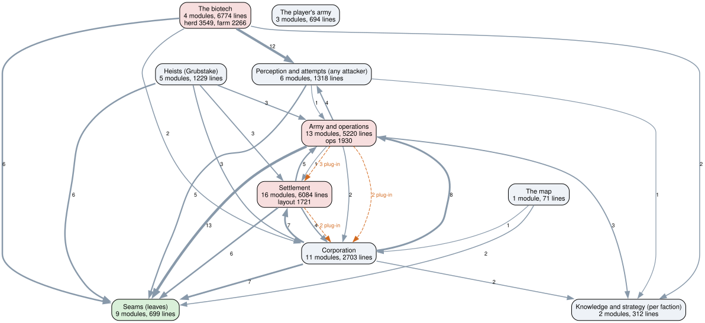
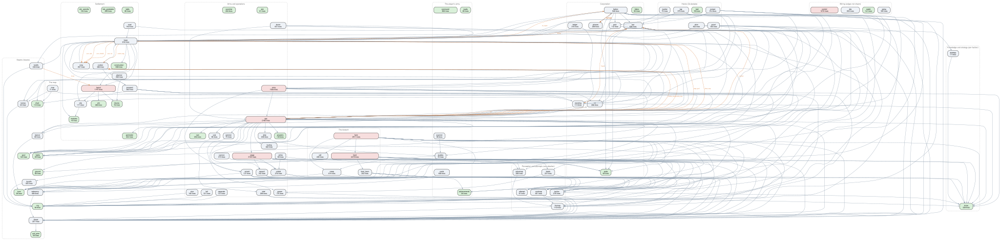

# The AI at a glance (generated)

Generated by `scripts/ai_graph.py` from the code; `check.sh` fails when it no longer matches. Do not edit: change the code and regenerate. The design and its reasons are in `docs/ai.md`.

## Structure

By layer: modules and lines in each, the requires between layers (solid, counted) and the plug-ins (dashed).

Every module:

Boxes are modules, sized by lines, in their layers (green: a leaf, it requires no other module; red: over 1,000 lines; control and dev wire everything and their edges are left out). Solid arrows are requires. Dashed arrows are functions one module plugs into another at load time (`a.f = b.f`): `a` calls `b` without requiring it, so the requires alone hide these edges.

| Module | Lines | Requires | Required by | Calls in by plug-in | Tick cadences | Events | Storage keys written |
|---|---|---|---|---|---|---|---|
| `herd` | 3396 | attempt, costmap, feeds, firemap, ground, herd_learn, know, tactics, threat, valuemap | control, farm |  | 60, 600, 3600 |  | biotech_priced_in_health, herd |
| `farm` | 2317 | cell, costmap, creep, feeds, firemap, herd, know, pods, rng, tactics, threat, tune, valuemap | control, dev |  | 60, 600, 3600, 36000 |  | biotech_time_parts, carrying, farms |
| `ops` | 2016 | answers, attempt, cuts, ground, intel, jammer, know, perimeter, pool, power, rd, routing, siege, stance, strip, tactics, threat, tune | army, base, border, control, cordon, crew, dev, dome, faction, jumper, ledger, prospect, prowl, skim, standing, tap, trade, war | base.claim_map, border.border_cap, cordon.cordon_check, cordon.cordon_step, trade.truce, war.corridor | 60, 300, 600, 1800, 3600 |  | alerts, budget_holds, corps, threat_last |
| `siege` | 1756 | attempt, costmap, firemap, know, orbital, pods, tactics, threat, valuemap | ops |  |  |  | threat_last, unit_owner, ways_dumped |
| `layout` | 1739 | blocks, rng, site, wfc | base, control, faction |  |  |  |  |
| `control` | 941 | aim, army, bait, base, belts, biters, border, cell, command, cordon, costmap, creep, crew, dev, dome, faction, farm, feeds, firemap, herd, jammer, jumper, know, layout, ledger, map, marker, oplog, ops, orbital, pact, phases, pods, pool, prospect, prowl, rd, road, roads, scanner, scorcher, site, skim, stance, standing, strike, tactics, tap, threat, trade, tune, valuemap, war, watch |  |  |  | ai_command_completed, built_entity, cargo_pod_finished_descending, entity_damaged, entity_died, entity_spawned, player_alt_reverse_selected_area, player_alt_selected_area, player_reverse_selected_area, player_selected_area, robot_built_entity, rocket_launched, script_trigger_effect, tick, script_raised_built | arena_surfaces, armed, army_off, bases, belts_always, biotech_no_hold, biotech_no_orders, biotech_off, biotech_old_stock, biotech_pens_hold, biotech_unlearned, capture_off, choice_off, cmd, cordon_off, corps, crews_off, cuts_off, dome_charge, domes, drop_debug, drop_off, dump_ways, era_override, focus_off, gates_off, grow_to_line_off, grudge_fast, hazard_hold, hazard_off, herd_off, history_off, hq_fast, labs_off, ladder_fast, last_raze, leader_off, ledger_off, march_trace, mature_blocks, next_id, next_ore_off, night_off, notices, ops_off, owner, pact_off, perimeter_fast, phases_fast, player_razed, pods_off, prospect_home, prospect_pace, prospect_radius, prospect_uncharted, prospect_window, prowl, quiet, quiet_ticks, raids_off, rd_fast, relief_off, relief_ticks, rings, road_haul, road_lapse, seed_salt, sever_off, siege_tier, skim_off, sneak_off, strangle_off, strikes_off, strip_fast, sweeps_off, tap_step, trace, truces, tune_levers, unit_owner, way_in, wfc_core_off |
| `faction` | 911 | army, base, costmap, firemap, layout, names, ops, pact, pods, rd, site, threat, war | control, dev, phases | phases.gate_open, phases.on_trigger | 60, 600 |  | corps, faction, landing_jobs, landing_told, last_landing |
| `base` | 856 | army, blocks, chart, construction, layout, modules, names, ops, planner, rng, site | control, cordon, crew, dev, dome, faction, jumper, ledger, pact, prospect, prowl, road, skim, tap, trade, war | cordon.cordon_ring, crew.crew_far, crew.crew_rebuild, crew.crew_take, faction.on_export, ops.siege_goal, war.footing | 7, 60, 120, 600, 3600, 7200 |  | lab_look, next_id, wrecks |
| `army` | 777 | know, ops, pool, rd, rng, tune | base, control, dev, faction, war |  | 60, 300, 600 |  |  |
| `war` | 614 | army, base, ops, pods, pool, rd, rng, stance, strategy, threat, tune | control, faction, jumper, tap | standing.forgive | 600 |  | corps, failed_sites, orbitals, reliefs |
| `command` | 576 | (leaf) | control |  | 60, 120 |  | cmd |
| `creep` | 568 | costmap, tune | control, farm |  |  |  | creep |
| `crew` | 483 | base, ops, standing | control |  | 30 |  | crew_owner |
| `skim` | 421 | base, ops, stance, tune | control |  | 60, 600 |  |  |
| `routing` | 420 | threat | ops |  |  |  | corridors |
| `costmap` | 415 | firemap, threat | control, creep, faction, farm, herd, siege |  |  |  |  |
| `cell` | 402 | pods | control, farm |  |  |  | cell_sites, cells |
| `rd` | 396 | know | army, control, faction, ops, planner, war | ops.era |  |  | corps |
| `cordon` | 385 | base, ops, prospect | control |  |  |  |  |
| `construction` | 383 | (leaf) | base |  |  |  |  |
| `wfc` | 380 | (leaf) | layout |  |  |  |  |
| `tap` | 375 | base, ops, pool, tune, war | control, dev |  | 60, 600 |  |  |
| `prospect` | 352 | base, chart, ops, pool, standing | control, cordon |  | 60, 3600 |  | prospect_failed |
| `planner` | 338 | rd | base |  |  |  |  |
| `perimeter` | 327 | (leaf) | ops |  |  |  |  |
| `jumper` | 314 | base, ops, threat, tune, war | control, dev |  | 60, 600 |  |  |
| `dome` | 299 | base, ops, threat | control |  | 60, 3600 |  | dome_alert |
| `intel` | 289 | know, threat | ops |  |  |  |  |
| `lots_grubstake` | 266 | (leaf) |  |  |  |  |  |
| `ledger` | 262 | base, ops, standing | control |  | 60, 600 |  | truces |
| `threat` | 262 | unit_prior | attempt, control, costmap, dome, faction, farm, feeds, firemap, herd, herd_learn, intel, jumper, ops, orbital, power, prowl, routing, siege, strike, war |  |  |  |  |
| `tactics` | 260 | know, rng | control, farm, herd, herd_learn, ops, siege |  |  |  |  |
| `orbital` | 239 | threat | control, siege |  | 10, 30 |  | kh_shadows, kh_strikes |
| `herd_learn` | 237 | attempt, firemap, know, tactics, threat | herd |  |  |  |  |
| `know` | 235 | (leaf) | army, control, farm, herd, herd_learn, intel, ops, rd, siege, strategy, tactics |  | 3600 |  | know |
| `phases` | 232 | faction | control |  | 360, 3600 |  | phases |
| `strip` | 229 | (leaf) | ops |  |  |  | threat_last |
| `feeds` | 227 | power, threat | control, farm, herd |  |  |  |  |
| `valuemap` | 208 | firemap | control, farm, herd, oplog, siege |  |  |  |  |
| `dev` | 196 | army, base, faction, farm, jumper, names, ops, standing, tap | control |  |  |  | cordon_off, era_override, hq_fast, trace |
| `oplog` | 185 | attempt, valuemap | control |  |  |  | oplog |
| `power` | 175 | threat | feeds, ops |  |  |  |  |
| `firemap` | 170 | threat | control, costmap, faction, farm, herd, herd_learn, siege, valuemap |  |  |  |  |
| `site` | 168 | modules | base, control, faction, layout |  |  |  |  |
| `trade` | 168 | base, ops, standing | control |  | 60 |  | posts, tributes, truces |
| `prowl` | 150 | base, ops, pool, threat | control |  |  |  |  |
| `road` | 143 | base, standing | control |  | 60 |  |  |
| `pool` | 142 | (leaf) | army, control, cuts, ops, prospect, prowl, tap, war |  |  |  |  |
| `watch` | 141 | (leaf) | control |  |  |  | watch |
| `wfc_serenity` | 134 | (leaf) |  |  |  |  |  |
| `answers` | 130 | (leaf) | ops |  |  |  |  |
| `standing` | 115 | ops | border, control, crew, dev, ledger, map, prospect, road, trade |  | 3600 |  | corps, incidents, standing_seen |
| `chart` | 114 | (leaf) | base, border, map, prospect |  |  |  |  |
| `scorcher` | 110 | (leaf) | control |  | 3600 |  | scorch, scorch_bursts, tesla_drains |
| `border` | 108 | chart, ops, standing | control |  | 600 |  | borders |
| `pact` | 107 | base | control, faction, marker |  | 600 |  | pact_broken, pact_state |
| `scanner` | 90 | (leaf) | control |  |  |  | scanners |
| `belts` | 86 | (leaf) | control |  |  |  |  |
| `cuts` | 86 | pool | ops |  |  |  |  |
| `aim` | 81 | (leaf) | control |  |  |  | aim_redirected |
| `stance` | 78 | tune | control, ops, skim, war |  |  |  | last_raze |
| `strategy` | 77 | know | war |  |  |  |  |
| `blocks` | 76 | (leaf) | base, layout |  |  |  |  |
| `jammer` | 73 | (leaf) | control, ops |  |  |  | jam_beams, jammed, jammers |
| `map` | 71 | chart, names, standing | control |  | 600 |  |  |
| `strike` | 67 | threat | control |  | 60 |  | orbitals, strike_targets, strikes, strikes_fired |
| `pods` | 64 | (leaf) | cell, control, faction, farm, siege, war |  | 60 |  | pods |
| `attempt` | 62 | threat | herd, herd_learn, oplog, ops, siege |  |  |  |  |
| `marker` | 61 | pact | control |  | 60 |  | breakers, claim_markers, pact_breaks, pact_suspended_till |
| `bait` | 59 | (leaf) | control |  | 30 |  | baits, baits_called |
| `rng` | 56 | (leaf) | army, base, farm, layout, names, tactics, war |  |  |  |  |
| `names` | 54 | rng | base, dev, faction, map |  |  |  | camp_names |
| `ground` | 38 | (leaf) | herd, ops |  |  |  |  |
| `biters` | 36 | (leaf) | control |  |  |  | evo_refunds, nests_cleared |
| `tune` | 32 | (leaf) | army, control, creep, farm, jumper, ops, skim, stance, tap, war |  |  |  |  |
| `unit_prior` | 29 | (leaf) | threat |  |  |  |  |
| `roads` | 28 | (leaf) | control |  |  |  |  |
| `modules` | 19 | (leaf) | base, site |  |  |  |  |

## Behaviour

### Tempers and answers

| Corporation | Temper | Capabilities by level | Answers a loss with | Answers trespass with |
|---|---|---|---|---|
| grubstake | jumps, loots, night, pact, prospects, skims, sneaks, soft_only, strips, taps | headquarters=3, lp-harrier=1, pickets_see=2 | snatch | snatch |
| serenity | bills, cuts, hostile, provoked_only | headquarters=3, lp-laser-drone=2, lp-walker=2, pickets_see=2, siege=1 | raid | siege |

### What each act is allowed, by standing

From `stance.may`, run on the mod's own tables. Yes: allowed. No: forbidden. A dash: the corporation does not have the act at all (its temper lacks it), whatever the standing. Siege also needs its level or a grudge.

| Corporation | Standing | raid | siege | answer | strip | tap | flare | jump | prospect | war |
|---|---|---|---|---|---|---|---|---|---|---|
| grubstake | rival | yes | grudge only | yes | yes | yes | yes | yes | yes | no |
| grubstake | enemy | yes | grudge only | yes | yes | yes | yes | yes | yes | yes |
| grubstake | truce | no | no | no | no | no | no | no | yes | no |
| serenity | rival | yes | yes | yes | - | - | yes | - | - | yes |
| serenity | enemy | yes | yes | yes | - | - | yes | - | - | yes |
| serenity | truce | no | no | no | - | - | no | - | - | no |

### The ladder: what reads which rung

| Module | Rung | Line |
|---|---|---|
| `army` | 2 | `if (b.war_rung or 0) >= 2 then n = math.floor(n * 1.5) end` |
| `jumper` | 2 | `local RUNG = 2` |
| `ops` | 1 | `if cap_ and rung < 3 and (t.exposure or t.defence or 0) > (rung >= 1 and math.max(cap_, LADDER_SOFT) or cap_) ` |
| `ops` | 1 | `if c.player and (c.floor or c.rung >= 1) then r = r * w.pressure end` |
| `ops` | 2 | `if shared.is_player_force(f) and ladder(f.name, b.force) >= 2` |
| `ops` | 3 | `local desperate = player and ladder(t.owner, b.force) >= 3` |
| `ops` | 3 | `local desperate = against_player(t.owner) and ladder(t.owner, b.force) >= 3` |
| `ops` | 3 | `if not route and not shared.capable(b.corp, "siege", 99) and against_player(t.owner) and ladder(t.owner, b.for` |
| `ops` | 1 | `local worth = (t.value or 0) * (t.line and 2 or 1) * (ladder(t.owner, b.force) >= 1 and 3 or 1)` |
| `ops` | 2 | `and (worth >= PUSH_VALUE or ladder(t.owner, b.force) >= 2) then` |
| `ops` | 3 | `if want > n and not op.regrouping and not (t.owner and against_player(t.owner) and ladder(t.owner, b.force) >=` |
| `ops` | 3 | `if st_ and against_player(st_.owner) and ladder(st_.owner, b.force) >= 3 then` |
| `routing` | 3 | `if t.owner and ladder(t.owner, b.force) >= 3 then return 1000, sp, worms end` |
| `routing` | 1 | `local worth = (t.value or 0) * (t.line and 2 or 1) * ((t.owner and ladder(t.owner, b.force) >= 1) and 3 or 1)` |
| `routing` | 2 | `if worth < PUSH_VALUE and not (t.owner and ladder(t.owner, b.force) >= 2) then return nil, sp, worms end` |
| `siege` | 3 | `if against_player(t.owner) and (b.war_rung or 0) >= 3 then k = k + 1 end` |
| `siege` | 3 | `cap_k = math.min(cap_k, budget(t.owner) + (b.grudge and 1 or 0) + ((b.war_rung or 0) >= 3 and 1 or 0))` |
| `siege` | 3 | `best = math.max(best, math.min(#SIEGE_TIERS, budget(f.name) + (b.grudge and 1 or 0) + ((b.war_rung or 0) >= 3 ` |
| `strategy` | 2 | `local arm = (i.rung >= 2 and w.rung_arm or 1) * (i.grudge and w.grudge_arm or 1) * (1 + w.threat_arm * pressed` |
| `war` | 1 | `if owner and rung >= 1 and s > 0 and (not pick or rung > prung or (rung == prung and s > short)) then` |

### The levers: what each drives

| Lever | Module | Line |
|---|---|---|
| aggression | `answers` | `b.next_answer = game.tick + tune.sooner(b.corp, ANSWER_COOLDOWN)` |
| strength | `army` | `n = math.max(1, math.floor(n * tune.strength(b.corp) + 0.5))` |
| strength | `creep` | `local got = took * shared.YIELD * tune.strength("biotech") * creep.evo_rate(surface)` |
| aggression | `farm` | `last_wave = game.tick - tune.sooner("biotech", WAVE_GAP) + tune.sooner("biotech", FIRST_WAVE), landed = game.t` |
| aggression | `farm` | `last_wave = game.tick - tune.sooner("biotech", WAVE_GAP) + tune.sooner("biotech", FIRST_WAVE), landed = game.t` |
| strength | `farm` | `creep.earn(creep.of(f.id), seeded and seeded.biomass or START_BIOMASS * tune.strength("biotech"))` |
| strength | `farm` | `local t = #f.pens * TRICKLE / 6 * tune.strength("biotech") * creep.evo_rate(surface)` |
| aggression | `farm` | `if not storage.herd_off and not herd.out(id) and tick - f.last_wave >= tune.sooner("biotech", WAVE_GAP) then s` |
| aggression | `farm` | `f.last_wave = game.tick - tune.sooner("biotech", WAVE_GAP)` |
| aggression | `jumper` | `b.next_jump = game.tick + (storage.jump_cooldown or tune.sooner(b.corp, COOLDOWN))` |
| aggression | `ops` | `b.next_op = game.tick + tune.sooner(b.corp, (outcome == "done" or outcome == "spent" or outcome == "claimed") ` |
| aggression | `skim` | `b.next_skim = game.tick + (cool or (storage.skim_cooldown or tune.sooner(b.corp, COOLDOWN)))` |
| aggression | `stance` | `local m = (game.tick - t0) / 3600 * (storage.ladder_fast and 10 or 1) * (corp and tune.aggression(corp) or 1)` |
| aggression | `tap` | `b.next_tap = game.tick + (storage.tap_cooldown or tune.sooner(b.corp, COOLDOWN))` |
| aggression | `war` | `if tick - since >= span * tune.aggression(b.corp) then` |

Presets: very-low 0.5, low 0.75, normal 1, high 1.5, very-high 2.
