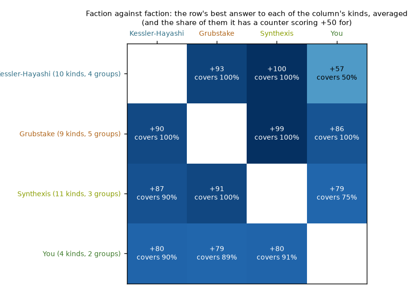

# The arena: who counters whom (generated)

Written by `scripts/arena_report.py` from `docs/arena/results.jsonl` (4080 fights, 3 rounds; `scripts/arena.sh` fights them headless, `tests/lp-arena/batch.lua` says which). Do not edit by hand.

Each unit kind fights each other at equal spend (as near as whole units allow, about 420 parts a side), both ways round, and a 420-part squad of it meets three biter waves of 20 and three of your lines (no research). A cell is the row's score: the share of the other side it destroyed minus the share of its own value it lost, from -100 (wiped out, took nothing) to +100. Rows are grouped by class (below), strongest first within each.

## Classes

A class is a body and a weapon: **small arms** (many light bodies, small shots), **splash** (one weapon that hits several at once: a blast, an arc, a split beam), **armour** (a heavy hull whose flat resistance eats small shots), **air** (fliers: only weapons that can shoot up touch them; `docs/units.md` says which). The class against class score is the mean of its kinds' cells.

| Row against column | small arms | splash | armour | air | anti-air | bred | bred on creep |
|---|---|---|---|---|---|---|---|
| small arms | +0 | -51 | -20 | +47 | +47 | -23 | -42 |
| splash | +51 | +0 | -56 | -100 | +86 | +23 | +51 |
| armour | +20 | +56 | +0 | -67 | +82 | -2 | -13 |
| air | -47 | +100 | +67 | +0 | -88 | +93 | +95 |
| anti-air | -47 | -86 | -82 | +88 | +0 | -58 | -62 |
| bred | +23 | -23 | +2 | -93 | +58 | +0 | -7 |
| bred on creep | +42 | -51 | +13 | -95 | +62 | +7 | +0 |

## Each kind's counters

| Kind (price) | Beats most (its score) | Beaten most by (their score) |
|---|---|---|
| rocket trooper (20) | scavenger (95), harrier (95), lightning tank (85) | bred small (81), battle tank (71), breacher (70) |
| slug (30) | scavenger (98), harrier (94), flak buggy (89) | bred big (creep) (87), heavy tank (80), bred big (71) |
| shotgun hand (8) | bred small (98), bred spore (90), flak buggy (84) | scavenger (100), harrier (100), bred big (100) |
| trooper (10) | scavenger (97), harrier (97), bred small (96) | bred big (100), bred big (creep) (100), bred behemoth (100) |
| laser trooper (10) | scavenger (97), harrier (96), bred behemoth (83) | tank (86), battle tank (86), lightning tank (83) |
| railgunner (22) | bred small (100), bred medium (100), bred big (100) | laser tank (100), scavenger (100), harrier (100) |
| heavy laser trooper (16) | scavenger (96), harrier (96), bred behemoth (69) | bred stomper (89), bred big (creep) (84), battle tank (83) |
| buggy (15) | scavenger (97), harrier (96), bred spore (77) | laser tank (100), lightning tank (100), bred big (100) |
| laser tank (100) | railgunner (100), shock (100), bred big (100) | scavenger (100), harrier (100), tank (100) |
| shock (30) | bred small (93), buggy (92), shotgun hand (90) | laser tank (100), scavenger (100), harrier (100) |
| breacher (10) | bred small (100), bred medium (93), shotgun hand (92) | scavenger (100), harrier (100), heavy tank (100) |
| lightning tank (100) | railgunner (100), shock (100), sapper (100) | scavenger (100), harrier (100), heavy tank (100) |
| sapper (30) | buggy (93), flak buggy (93), shotgun hand (92) | scavenger (100), harrier (100), lightning tank (100) |
| battle tank (60) | railgunner (100), laser tank (100), lightning tank (100) | scavenger (100), harrier (100), dozer (56) |
| heavy tank (95) | railgunner (100), laser tank (100), breacher (100) | scavenger (100), harrier (100), bred stomper (67) |
| dozer (100) | railgunner (100), laser tank (100), lightning tank (100) | scavenger (100), harrier (100), bred stomper (100) |
| tank (60) | laser tank (100), flak buggy (100), bred stomper (100) | scavenger (100), harrier (100), battle tank (83) |
| walker (100) | railgunner (100), sapper (100), breacher (100) | bred behemoth (100), bred big (92), bred big (creep) (92) |
| scorcher (70) | flak buggy (100), laser trooper (83), railgunner (83) | scavenger (100), harrier (100), bred big (100) |
| harrier (40) | railgunner (100), shock (100), shotgun hand (100) | anti-air trooper (100), flak buggy (100), walker (100) |
| scavenger (50) | railgunner (100), shock (100), shotgun hand (100) | flak buggy (100), walker (100), slug (98) |
| anti-air trooper (18) | harrier (100), scavenger (97), bred spore (81) | bred stomper (100), bred big (creep) (94), bred big (92) |
| flak buggy (20) | scavenger (100), harrier (100), bred spore (89) | laser tank (100), lightning tank (100), tank (100) |
| bred spore (10) | scavenger (81), harrier (53), heavy laser trooper (-40) | bred stomper (100), bred behemoth (100), walker (100) |
| bred stomper (150) | railgunner (100), laser tank (100), anti-air trooper (100) | scavenger (100), harrier (100), tank (100) |
| bred behemoth (200) | shock (100), shotgun hand (100), sapper (100) | scavenger (100), railgunner (95), laser trooper (83) |
| bred burster (70) | buggy (100), scorcher (100), shotgun hand (83) | railgunner (100), scavenger (100), harrier (100) |
| bred big (28) | shotgun hand (100), trooper (100), buggy (100) | railgunner (100), laser tank (100), scavenger (100) |
| bred medium (7) | buggy (98), bred small (95), bred spore (92) | railgunner (100), scavenger (100), harrier (100) |
| bred spitter (9) | dozer (95), bred small (89), scorcher (55) | railgunner (100), scavenger (100), harrier (100) |
| bred small (2) | rocket trooper (81), bred behemoth (68), bred spore (68) | railgunner (100), breacher (100), scavenger (100) |
| bred big (creep) (28) | shotgun hand (100), trooper (100), buggy (100) | railgunner (100), scavenger (100), laser tank (96) |
| bred medium (creep) (7) | buggy (98), flak buggy (98), scorcher (97) | railgunner (100), scavenger (100), harrier (100) |
| bred spitter (creep) (9) | dozer (95), bred small (92), buggy (59) | railgunner (100), scavenger (100), harrier (100) |

## Groups found from the fights alone

Each kind is its row of scores (against every kind and every fixed opponent); kinds are joined by average linkage on the distance between rows, so two kinds land together when they beat and lose to the same things (`scripts/arena_report.py`, scipy). Cut into 7 groups, as many as the hand-made classes:

| Group | Kinds (hand-made class) |
|---|---|
| 1 | laser tank (splash), shock (splash), breacher (splash), lightning tank (splash), sapper (splash), battle tank (armour), heavy tank (armour), dozer (armour), tank (armour), bred stomper (bred), bred behemoth (bred), bred burster (bred), bred big (bred), bred medium (bred), bred big (creep) (bred on creep), bred medium (creep) (bred on creep) |
| 2 | rocket trooper (small arms), slug (small arms), trooper (small arms), laser trooper (small arms), heavy laser trooper (small arms), buggy (small arms), anti-air trooper (anti-air), flak buggy (anti-air), bred spore (anti-air) |
| 3 | shotgun hand (small arms), bred spitter (bred), bred small (bred), bred spitter (creep) (bred on creep) |
| 4 | harrier (air), scavenger (air) |
| 5 | railgunner (small arms) |
| 6 | walker (armour) |
| 7 | scorcher (armour) |

## Faction against faction

From the unit matrix, each faction's roster (the kinds it fields from landing or its tree; a kind both corporations field counts for both; Synthexis's breeds on creep too). **Answer**: for each of the other side's kinds, the row's best score against it, averaged: can it answer whatever the other fields? **Coverage**: the share of the other side's kinds it has a counter scoring +50 or more for. **Exposure**: the share of its own kinds the other side has such a counter for. **Breadth**: how many of the groups found from the fights alone (above) its roster spans.

| Row against column | Answer | Coverage | Exposure | Their answer | Edge |
|---|---|---|---|---|---|
| Kessler-Hayashi against Grubstake | +93 | 100% | 100% | +90 | +2 |
| Kessler-Hayashi against Synthexis | +100 | 100% | 90% | +87 | +13 |
| Kessler-Hayashi against You | +57 | 50% | 90% | +80 | -24 |
| Grubstake against Kessler-Hayashi | +90 | 100% | 100% | +93 | -2 |
| Grubstake against Synthexis | +99 | 100% | 100% | +91 | +8 |
| Grubstake against You | +86 | 100% | 89% | +79 | +7 |
| Synthexis against Kessler-Hayashi | +87 | 90% | 100% | +100 | -13 |
| Synthexis against Grubstake | +91 | 100% | 100% | +99 | -8 |
| Synthexis against You | +79 | 75% | 91% | +80 | -1 |
| You against Kessler-Hayashi | +80 | 90% | 50% | +57 | +24 |
| You against Grubstake | +79 | 89% | 100% | +86 | -7 |
| You against Synthexis | +80 | 91% | 75% | +79 | +1 |

| Faction | Kinds | Breadth (groups of 7) | Roster |
|---|---|---|---|
| Kessler-Hayashi | 10 | 4 | laser trooper, railgunner, heavy laser trooper, laser tank, shock, lightning tank, heavy tank, tank, walker, anti-air trooper |
| Grubstake | 9 | 5 | slug, shotgun hand, buggy, sapper, dozer, scorcher, harrier, scavenger, flak buggy |
| Synthexis | 11 | 3 | bred spore, bred stomper, bred behemoth, bred burster, bred big, bred medium, bred spitter, bred small, bred big (creep), bred medium (creep), bred spitter (creep) |
| You | 4 | 2 | rocket trooper, trooper, breacher, battle tank |

## Mixed arms: does a flier soak a ground army's fire?

A ground army against the same spend with part of it in fliers, both ways round. Ground-only weapons cannot hurt a flier; a unit whose shot is aimed at one is turned to a ground target it can hurt (`landing-party/scripts/aim.lua`). The score is the all-ground army's.

| Mix | All-ground army's score | Fights |
|---|---|---|
| prisms / prisms + harriers | -48 | 6 |
| tanks and rifles / with harriers | +33 | 6 |
| tanks / tanks + harriers | -48 | 6 |
| dozers / dozers + harriers | -35 | 6 |
