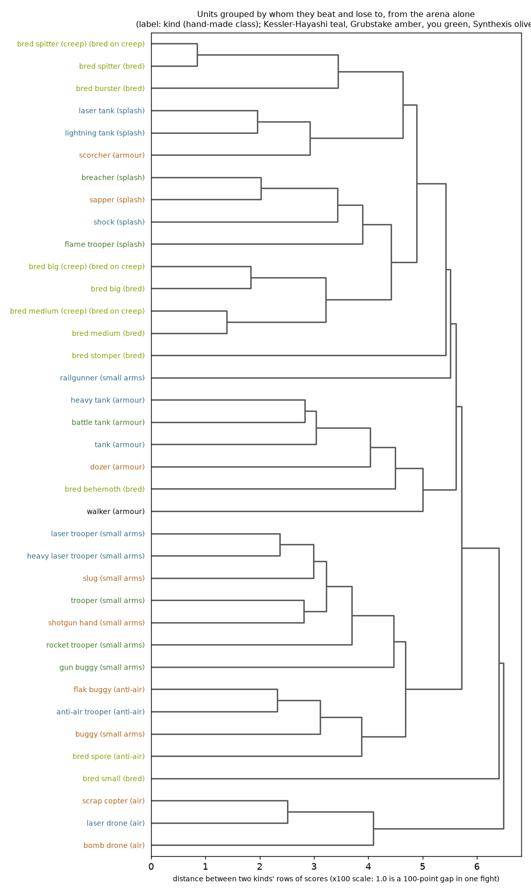

# The arena: who counters whom (generated)

Written by `scripts/arena_report.py` from `docs/arena/results.jsonl` (4884 fights, 3 rounds; `scripts/arena.sh` fights them headless, `tests/lp-arena/batch.lua` says which). Do not edit by hand.

Each unit kind fights each other at equal spend (as near as whole units allow, about 420 parts a side), both ways round, and a 420-part squad of it meets three biter waves of 20 and three of your lines (no research). A cell is the row's score: the share of the other side it destroyed minus the share of its own value it lost, from -100 (wiped out, took nothing) to +100. Rows are grouped by class (below), strongest first within each.

## Classes

A class is a body and a weapon: **small arms** (many light bodies, small shots), **splash** (one weapon that hits several at once: a blast, an arc, a split beam), **armour** (a heavy hull whose flat resistance eats small shots), **air** (fliers: only weapons that can shoot up touch them; `docs/units.md` says which). The class against class score is the mean of its kinds' cells.

| Row against column | small arms | splash | armour | air | anti-air | bred | bred on creep |
|---|---|---|---|---|---|---|---|
| small arms | +0 | -28 | +2 | +67 | +33 | -14 | -41 |
| splash | +28 | +0 | -52 | -77 | +59 | +26 | +45 |
| armour | -2 | +52 | +0 | -24 | +80 | -8 | -13 |
| air | -67 | +77 | +24 | +0 | -74 | +52 | +53 |
| anti-air | -33 | -59 | -80 | +74 | +0 | -38 | -47 |
| bred | +14 | -26 | +8 | -52 | +38 | +0 | -9 |
| bred on creep | +41 | -45 | +13 | -53 | +47 | +9 | +0 |

## Each kind's counters

| Kind (price) | Beats most (its score) | Beaten most by (their score) |
|---|---|---|
| rocket trooper (20) | scrap copter (100), laser drone (95), lightning tank (88) | bred small (81), breacher (60), shotgun hand (58) |
| shotgun hand (8) | scrap copter (98), bred small (97), bred spore (92) | bred big (100), bred behemoth (100), bred big (creep) (100) |
| gun buggy (40) | flame trooper (100), scrap copter (100), laser drone (93) | bred behemoth (100), battle tank (97), heavy tank (83) |
| heavy laser trooper (14) | scrap copter (98), laser drone (81), dozer (75) | shock (73), gun buggy (68), bred medium (creep) (67) |
| slug (30) | scrap copter (99), laser drone (92), flak buggy (87) | bred big (creep) (86), bred big (80), bred small (73) |
| laser trooper (11) | scrap copter (97), laser drone (79), dozer (74) | bred big (creep) (83), breacher (81), gun buggy (80) |
| trooper (10) | scrap copter (98), bred small (96), bred spore (74) | bred big (100), bred behemoth (100), bred big (creep) (100) |
| railgunner (22) | bred small (100), bred spore (98), bred spitter (97) | walker (100), dozer (100), bred behemoth (100) |
| buggy (15) | scrap copter (98), bred small (88), bred spore (73) | bred big (100), heavy tank (100), dozer (100) |
| shock (30) | bred small (92), bred spore (83), railgunner (77) | laser drone (100), scorcher (100), lightning tank (100) |
| sapper (30) | bred small (95), bred burster (90), bred spitter (creep) (81) | laser drone (100), scorcher (100), walker (100) |
| breacher (10) | bred small (100), bred medium (94), bred spore (92) | walker (100), bred behemoth (100), bred stomper (100) |
| lightning tank (115) | shock (100), flame trooper (100), bred spore (96) | laser drone (100), heavy tank (100), dozer (100) |
| flame trooper (20) | bred small (89), railgunner (80), bred medium (75) | laser tank (100), laser drone (100), scorcher (100) |
| laser tank (115) | flame trooper (100), bred small (92), bred spore (79) | laser drone (100), heavy tank (100), dozer (100) |
| walker (100) | railgunner (100), sapper (100), flak buggy (100) | bred behemoth (100), bred big (creep) (93), bred big (90) |
| tank (65) | flak buggy (100), flame trooper (100), breacher (97) | scrap copter (82), walker (75), dozer (67) |
| battle tank (80) | laser tank (100), flak buggy (100), flame trooper (100) | scrap copter (84), walker (71), shotgun hand (71) |
| dozer (120) | railgunner (100), buggy (100), laser tank (100) | bred stomper (100), bred spitter (creep) (94), bred spitter (94) |
| heavy tank (120) | shock (100), buggy (100), laser tank (100) | laser drone (95), scrap copter (90), bred stomper (75) |
| scorcher (100) | shock (100), sapper (100), flame trooper (100) | walker (100), heavy tank (100), bred behemoth (100) |
| laser drone (70) | shock (100), sapper (100), laser tank (100) | flak buggy (100), anti-air trooper (97), rocket trooper (95) |
| scrap copter (15) | bred burster (100), bred small (100), bred spitter (creep) (98) | anti-air trooper (100), flak buggy (100), walker (100) |
| bomb drone (28) | bred burster (73), sapper (69), railgunner (67) | walker (75), slug (71), trooper (71) |
| anti-air trooper (18) | scrap copter (100), laser drone (97), bred spitter (creep) (91) | bred stomper (100), walker (92), bred big (92) |
| flak buggy (20) | laser drone (100), scrap copter (100), bred small (91) | walker (100), heavy tank (100), dozer (100) |
| bred spore (10) | laser drone (81), scrap copter (79), rocket trooper (-12) | walker (100), bred behemoth (100), bred stomper (100) |
| bred stomper (150) | railgunner (100), laser tank (100), anti-air trooper (100) | bred behemoth (100), walker (94), scrap copter (90) |
| bred behemoth (200) | railgunner (100), shock (100), sapper (100) | laser trooper (74), heavy laser trooper (74), laser drone (69) |
| bred big (28) | buggy (100), shotgun hand (100), trooper (100) | shock (68), laser drone (67), bred stomper (67) |
| bred medium (7) | buggy (98), bred small (96), bred spore (89) | laser drone (100), bred stomper (100), breacher (94) |
| bred spitter (9) | dozer (94), bred small (93), bred medium (66) | laser drone (100), bred stomper (100), railgunner (97) |
| bred burster (40) | lightning tank (27), bred spitter (25), bred spitter (creep) (17) | laser drone (100), scrap copter (100), railgunner (93) |
| bred small (2) | rocket trooper (81), slug (73), battle tank (66) | railgunner (100), laser drone (100), scorcher (100) |
| bred big (creep) (28) | buggy (100), shotgun hand (100), trooper (100) | shock (64), laser drone (50), sapper (43) |
| bred medium (creep) (7) | buggy (98), bred small (98), trooper (94) | laser drone (100), bred behemoth (100), bred stomper (100) |
| bred spitter (creep) (9) | dozer (94), bred small (93), bred medium (63) | laser drone (100), bred stomper (100), scrap copter (98) |

## Groups found from the fights alone

Each kind is its row of scores (against every kind and every fixed opponent); kinds are joined by average linkage on the distance between rows, so two kinds land together when they beat and lose to the same things (`scripts/arena_report.py`, scipy). Cut into 7 groups, as many as the hand-made classes:

| Group | Kinds (hand-made class) |
|---|---|
| 1 | shock (splash), sapper (splash), breacher (splash), lightning tank (splash), flame trooper (splash), laser tank (splash), scorcher (armour), bred big (bred), bred medium (bred), bred spitter (bred), bred burster (bred), bred big (creep) (bred on creep), bred medium (creep) (bred on creep), bred spitter (creep) (bred on creep) |
| 2 | rocket trooper (small arms), shotgun hand (small arms), gun buggy (small arms), heavy laser trooper (small arms), slug (small arms), laser trooper (small arms), trooper (small arms), buggy (small arms), anti-air trooper (anti-air), flak buggy (anti-air), bred spore (anti-air) |
| 3 | walker (armour), tank (armour), battle tank (armour), dozer (armour), heavy tank (armour), bred behemoth (bred) |
| 4 | laser drone (air), scrap copter (air), bomb drone (air) |
| 5 | railgunner (small arms) |
| 6 | bred stomper (bred) |
| 7 | bred small (bred) |

## Faction against faction

From the unit matrix, each faction's roster (the kinds it fields from landing or its tree; a kind both corporations field counts for both; Synthexis's breeds on creep too). **Answer**: for each of the other side's kinds, the row's best score against it, averaged: can it answer whatever the other fields? **Coverage**: the share of the other side's kinds it has a counter scoring +50 or more for. **Exposure**: the share of its own kinds the other side has such a counter for. **Breadth**: how many of the groups found from the fights alone (above) its roster spans.

| Row against column | Answer | Coverage | Exposure | Their answer | Edge |
|---|---|---|---|---|---|
| Kessler-Hayashi against Grubstake | +83 | 89% | 100% | +88 | -5 |
| Kessler-Hayashi against Synthexis | +89 | 100% | 90% | +80 | +9 |
| Kessler-Hayashi against You | +71 | 83% | 90% | +78 | -8 |
| Grubstake against Kessler-Hayashi | +88 | 100% | 89% | +83 | +5 |
| Grubstake against Synthexis | +80 | 91% | 100% | +91 | -10 |
| Grubstake against You | +71 | 83% | 78% | +71 | +0 |
| Synthexis against Kessler-Hayashi | +80 | 90% | 100% | +89 | -9 |
| Synthexis against Grubstake | +91 | 100% | 91% | +80 | +10 |
| Synthexis against You | +72 | 83% | 82% | +73 | +0 |
| You against Kessler-Hayashi | +78 | 90% | 83% | +71 | +8 |
| You against Grubstake | +71 | 78% | 83% | +71 | +0 |
| You against Synthexis | +73 | 82% | 83% | +72 | +0 |

| Faction | Kinds | Breadth (groups of 7) | Roster |
|---|---|---|---|
| Kessler-Hayashi | 10 | 5 | heavy laser trooper, laser trooper, railgunner, shock, lightning tank, laser tank, tank, heavy tank, laser drone, anti-air trooper |
| Grubstake | 9 | 4 | shotgun hand, slug, buggy, sapper, dozer, scorcher, scrap copter, bomb drone, flak buggy |
| Synthexis | 11 | 5 | bred spore, bred stomper, bred behemoth, bred big, bred medium, bred spitter, bred burster, bred small, bred big (creep), bred medium (creep), bred spitter (creep) |
| You | 6 | 3 | rocket trooper, gun buggy, trooper, breacher, flame trooper, battle tank |

## Mixed arms: does a flier soak a ground army's fire?

A ground army against the same spend with part of it in fliers, both ways round. Ground-only weapons cannot hurt a flier; a unit whose shot is aimed at one is turned to a ground target it can hurt (`landing-party/scripts/aim.lua`). The score is the all-ground army's.

| Mix | All-ground army's score | Fights |
|---|---|---|
| tanks / tanks + harriers | +9 | 6 |
| dozers / dozers + harriers | +55 | 6 |
| tanks and rifles / with harriers | +70 | 6 |
| prisms / prisms + harriers | -21 | 6 |

## The breach: bursters among other biters at a wall

The same spend sent at gun turrets behind a wall two deep (`tests/lp-arena/batch.lua`, BREACH), as plain biters and with part of it in bursters. A burster bursts where it dies: alone it is shot short of the wall; among others it reaches it. Ranges over the rounds.

| Wave | Spend | Won | Turrets broken | Wall pieces broken | Units lost |
|---|---|---|---|---|---|
| 40 medium | 280 | 0 of 3 | 0 | 3 to 4 | 40 of 40 |
| 34 medium + 1 burster | 278 | 0 of 3 | 0 to 1 | 1 to 9 | 35 of 35 |
| 29 medium + 2 bursters | 283 | 0 of 3 | 3 to 5 | 14 to 15 | 31 of 31 |
| 23 medium + 3 bursters | 281 | 0 of 3 | 1 to 3 | 8 to 16 | 26 of 26 |
| 17 medium + 4 bursters | 279 | 0 of 3 | 1 to 3 | 9 to 16 | 21 of 21 |
| 7 bursters | 280 | 0 of 3 | 0 to 2 | 16 to 18 | 7 of 7 |
| 10 big | 280 | 3 of 3 | 10 | 8 to 10 | 1 of 10 |
| 6 big + 3 bursters | 288 | 3 of 3 | 10 | 17 to 20 | 3 to 4 of 9 |
