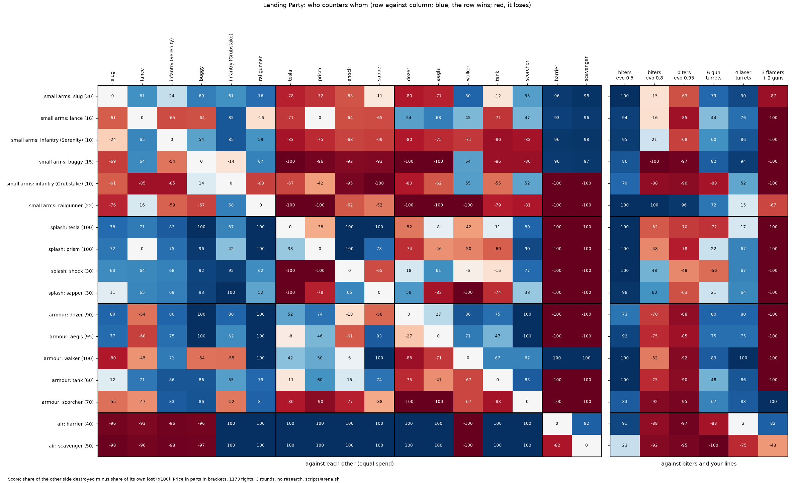

# The arena: who counters whom (generated)

Written by `scripts/arena_report.py` from `docs/arena/results.jsonl` (1173 fights, 3 rounds; `scripts/arena.sh` fights them headless, `tests/lp-arena/batch.lua` says which). Do not edit by hand.

Each unit kind fights each other at equal spend (as near as whole units allow, about 420 parts a side), both ways round, and a 420-part squad of it meets three biter waves of 20 and three of your lines (no research). A cell is the row's score: the share of the other side it destroyed minus the share of its own value it lost, from -100 (wiped out, took nothing) to +100. Rows are grouped by class (below), strongest first within each.

## Classes

A class is a body and a weapon: **small arms** (many light bodies, small shots), **splash** (one weapon that hits several at once: a blast, an arc, a split beam), **armour** (a heavy hull whose flat resistance eats small shots), **air** (fliers: only weapons that can shoot up touch them; `docs/units.md` says which). The class against class score is the mean of its kinds' cells.

| Row against column | small arms | splash | armour | air |
|---|---|---|---|---|
| small arms | +0 | -72 | -38 | +31 |
| splash | +72 | +0 | -8 | -100 |
| armour | +38 | +8 | +0 | -60 |
| air | -31 | +100 | +60 | +0 |

## Each kind's counters

| Kind (price) | Beats most (its score) | Beaten most by (their score) |
|---|---|---|
| slug (30) | scavenger (98), harrier (96), walker (80) | dozer (80), tesla (78), aegis (77) |
| lance (16) | scavenger (96), harrier (93), infantry (Grubstake) (85) | tank (71), tesla (71), sapper (65) |
| infantry (Serenity) (10) | scavenger (98), harrier (96), infantry (Grubstake) (85) | tank (86), tesla (83), scorcher (83) |
| buggy (15) | scavenger (97), harrier (96), railgunner (67) | tesla (100), aegis (100), dozer (100) |
| infantry (Grubstake) (10) | walker (55), scorcher (52), buggy (14) | sapper (100), scavenger (100), harrier (100) |
| railgunner (22) | infantry (Grubstake) (68), lance (16), sapper (-52) | scavenger (100), harrier (100), tesla (100) |
| tesla (100) | railgunner (100), shock (100), sapper (100) | scavenger (100), harrier (100), dozer (52) |
| prism (100) | railgunner (100), shock (100), buggy (96) | scavenger (100), harrier (100), dozer (74) |
| shock (30) | infantry (Grubstake) (95), buggy (92), scorcher (77) | scavenger (100), harrier (100), tesla (100) |
| sapper (30) | infantry (Grubstake) (100), buggy (93), infantry (Serenity) (69) | scavenger (100), harrier (100), tesla (100) |
| dozer (90) | railgunner (100), buggy (100), scorcher (100) | scavenger (100), harrier (100), sapper (58) |
| aegis (95) | railgunner (100), buggy (100), scorcher (100) | scavenger (100), harrier (100), lance (68) |
| walker (100) | railgunner (100), sapper (100), scavenger (100) | dozer (86), slug (80), aegis (71) |
| tank (60) | infantry (Serenity) (86), buggy (86), scorcher (83) | scavenger (100), harrier (100), dozer (75) |
| scorcher (70) | buggy (86), infantry (Serenity) (83), railgunner (81) | scavenger (100), harrier (100), aegis (100) |
| harrier (40) | railgunner (100), shock (100), sapper (100) | walker (100), infantry (Serenity) (96), slug (96) |
| scavenger (50) | railgunner (100), shock (100), sapper (100) | walker (100), slug (98), infantry (Serenity) (98) |

## Mixed arms: does a flier soak a ground army's fire?

A ground army against the same spend with part of it in fliers, both ways round. Ground-only weapons cannot hurt a flier; a unit whose shot is aimed at one is turned to a ground target it can hurt (`landing-party/scripts/aim.lua`). The score is the all-ground army's.

| Mix | All-ground army's score | Fights |
|---|---|---|
| prisms / prisms + harriers | -48 | 6 |
| tanks and rifles / with harriers | +54 | 6 |
| tanks / tanks + harriers | -33 | 6 |
| dozers / dozers + harriers | -42 | 6 |
