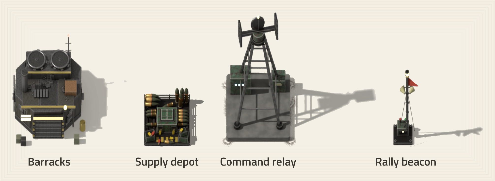
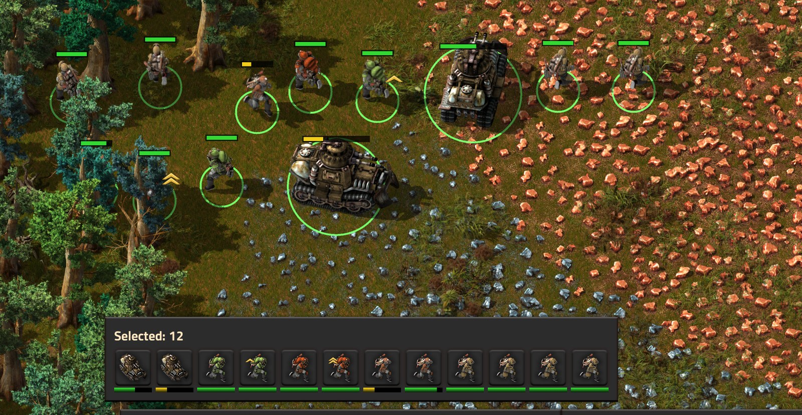
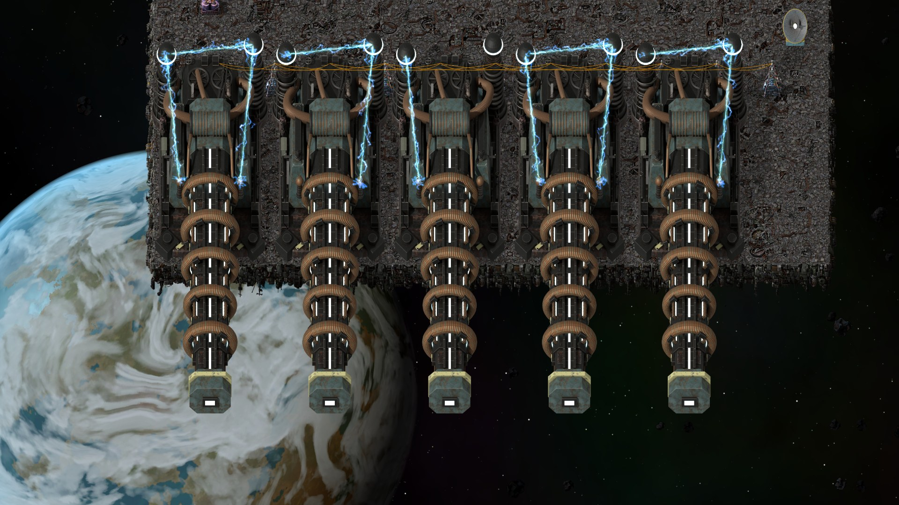
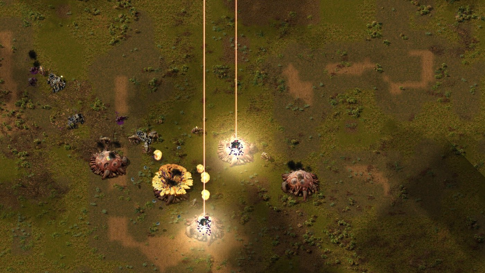

# Your army {.opener faction="player"}

::: {.epigraph faction="player"}
:::

You can raise an army of your own: troopers, breachers, rocket troopers, gun buggies, flame troopers and battle
tanks. They
are trained from the equipment you already make for yourself, and how many you can field is set by your command
bandwidth. You give them orders with rally beacons, the command tool or the circuit network.

## The barracks and orders

**Command bandwidth 1** unlocks the army: the barracks, the rally beacon, the command relay, the threat scanner,
troopers and breachers. It also gives you one command core. A barracks is built from an assembling machine
2, steel, electronic circuits and a command core. Cores cannot be crafted, so every barracks after the first needs one
from faction wreckage (see [Command cores](spoils.qmd#command-cores)).

The barracks is a training plant. It works like an assembling machine: it needs power, you pick what it trains as you
would pick a recipe, and a new barracks starts on troopers. What it makes is an *order*, built from your own kit:

| Order | Made from | Unlocked by |
|:--|:--|:--|
| Trooper | Heavy armor, a submachine gun, firearm magazines | Command bandwidth 1 |
| Breacher | Heavy armor, grenades, electronic circuits | Command bandwidth 1 |
| Rocket trooper | Heavy armor, a rocket launcher, rockets | Command bandwidth 2 |
| Gun buggy | A car, piercing rounds magazines, a personal battery | Command bandwidth 2 |
| Flame trooper | Heavy armor, a flamethrower, flamethrower ammo | Command bandwidth 3 |
| Battle tank | A tank, cannon shells, personal batteries, an exoskeleton, energy shields | Command bandwidth 3 |

A finished order steps out of the barracks as a unit and joins the nearest rally beacon. Troopers fight units. Breachers
throw demolition charges that wreck walls and turrets and do little to units. Rocket troopers kill armor and fliers.
Gun buggies are your fastest unit, an autocannon on a car that breaks up infantry, light vehicles and fliers and does
little to armor; in a defending squad they arrive first. Flame troopers burn swarms
of biters and bunched infantry but are outranged. Battle tanks take bases apart and take the longest to train. Every unit's numbers are in the [Reference](reference.qmd#sec-units). While your command
bandwidth is full, finished orders wait inside the barracks, and it stops once its output is full.

**Research.** Your military research upgrades your units as it does your own weapons. Physical projectile damage and
weapon shooting speed raise troopers, gun buggies and battle tanks, whatever round they fire; weapon shooting speed
also raises breachers and flame troopers; stronger explosives raise breachers and rocket
troopers; refined flammables raise flame troopers. Each unit's description names its research. Infantry trained
from heavy armor also take its resistance to acid, so worms and spitters hurt them less. Without military research, a
squad that clears corporation outposts will struggle against a large biter nest.

**Field repair.** Your units within  tiles of a powered barracks heal. Construction
robots repair them too, as they repair your turrets: a squad inside a roboport's area is mended with repair packs, and
your own personal roboport mends the units round you. Robots keep up poorly with units on the move, and they fly into the
fight to do it. Nowhere else does anything heal them, so a barracks or a roboport near the front works as a forward base. **Roads** help too: your units walk faster on
stone path, concrete and refined concrete, by the same bonus those floors give you.

**Gates and the map.** Your units open your own gates as they come to them, so a squad can march out of a walled base
and back in. They also chart the ground around them as they go, so you can follow a squad far beyond your radars.

## Your units {#sec-army-units}

::: {.tree tree="player-army"}
Each level of command bandwidth unlocks orders at the barracks. A unit's share of your bandwidth is under its name.
:::



## Rally beacons {#sec-beacons}

A rally beacon is a constant combinator. Each new unit joins the nearest beacon with room for it and follows it
until that beacon is removed; then it joins the nearest one again. A unit with no beacon nearby stands where it is, so
place a beacon before your first barracks finishes an order. Hover over a beacon and lines run from it to each unit of
its squad; hover over a unit and a line runs to its beacon.

Open the beacon and set a signal to give its squad a stance. With more than one, R comes first, then A, then D.
A panel beside the beacon's window says what the squad is doing.

- **No signal: hold.** The squad stands at the rally point and fights what comes to it. It also clears the nests and
  worms within its reach, the wild biters' and Synthexis's, nearest first.
- **A: advance.** The squad attacks the nearest enemy turret within reach of the rally point: a corporation's gun,
  laser, flamer, flak or artillery, or a Synthexis worm. Then the other military buildings there that no turret covers,
  then the corporations' masts, then Synthexis's pens. With none left, it holds.
- **R: retreat.** The squad walks back to the nearest barracks without stopping to fight, and heals there if the
  barracks has power.
- **D: defend.** The squad holds at the rally point until an attack comes within  tiles of
  it, then goes out to meet it. It answers what you would know of: a strike force whose pods your radar sees coming, or
  whose target you are told; a strike force that has landed; and corporation units, Synthexis's biters or wild biters at your
  buildings; and a corporation mortar, howitzer or tank shelling your walls, turrets or radars from range, which the
  squad goes for. It does not chase beyond the attack. When the strike force breaks, or no enemy has been near the place for
   seconds, the squad walks back. Its ring is green, drawn at the full reach.
- **Z: reach.** Z sets the squad's reach in tiles, up to : how far from the rally point it
  fights, advances and answers an attack, and how far E and T count. Without it, the reach is  tiles, and  for the attacks a defending squad answers. A small
  outpost's squad on a short reach defends only that outpost and stays home when your main base is attacked; a long one
  covers a wide outpost or a stretch of rail. The ring at the rally point shows the reach in use.

**Squad sizes.** Each kind of unit has a squad size signal, such as *Squad size: troopers*. Set one on a beacon and its
squad keeps at most that many of that unit. New units join the nearest beacon that still has room for them. When every
beacon in reach is full for a unit, its orders wait in the barracks, and a barracks whose output fills stops training.
Lower a squad size and the surplus, those farthest from the rally point first, join the nearest other beacon with room
for them; if none has room, they leave the squad and hold where they stand until you give them an order. This is how you
move units from one squad to another: lower one beacon's size and raise another's. The panel beside the beacon's
window shows each unit's count against its size, with buttons to change it; on a wired beacon the network sets the
sizes and the buttons are off. Raise it or clear it and the waiting orders deploy. A beacon with no squad size for a unit
takes as many as come. Wired to a circuit, the sizes can follow the factory, for example more tanks when the threat
scanner sees more corporation armour.

**The rally point.** Signals X and Y move the rally point that many tiles east and south of the beacon (negative values
move it west and north), up to  tiles. A ring at the rally point shows its reach, gray
for hold, red for advance, green for defend and blue for retreat, with a dashed line back to the beacon. A unit that
sees a corporation unit nearby attacks it before any building, but only inside the ring: your squads do not chase a
garrison back into its turrets.

**Roads.** Your units walk faster on paved ground, as you do: stone path, concrete and refined concrete. On a walk of
 tiles or more, to a rally point, out to an attack or to a point you ordered, a squad
leaves the straight line for a road when the road gets it there sooner. A road from the barracks to each beacon, and
out to where the attacks come, is worth laying; paving everything round it adds nothing. Corporation units do not
gain from your paving.

## The command tool {#sec-command-tool}

The command tool gives orders by hand. Take it from the shortcut bar or press ALT + C, once you have Command
bandwidth 1.

- **Drag** over your units to select them. Green rings, seen only by you, mark the selection.
- **Shift + drag** releases units back to their beacons.
- **Right-click** or right-drag on the ground moves the selection there. The units ignore fire on the way, then hold
  where they arrive.
- **Right-click** on an enemy building or unit attacks it: a corporation's, walls, gates and pylons included,
  Synthexis's, or a wild biter, nest or worm. When it falls, the
  units hold where it stood.
- **Right-click** on one of your rally beacons puts the selection in its squad, however far away the units are. If the
  beacon sets a squad size for them, the size goes up to take them. A beacon wired to a circuit keeps the circuit's
  size: the units beyond it stay where they are. Shift + right-click on a beacon does the same, but the units fight
  their way to it first. To attack-move without joining, click beside the beacon.
- **Shift + right-click** attack-moves: the units fight everything they meet on the way. Once there, they destroy the
  corporation and Synthexis buildings around that spot, defenses first, then the rest, then walls and gates, and hold.

**Razing.** A corporation's drills, generators, pylons and storage are not military targets: your units and turrets do
not fire at them by themselves. To destroy an outpost, attack-move onto it, or right-click its buildings. A corporation
does not rebuild while your units or turrets stand on the ground it would build on. A lander cannot be harmed while at least half of the generators near it stand. Hover
over the lander to see lines to each of them. Destroy those generators and the lander can be attacked.

A marker flashes where each order went. Selected units obey you over their beacon until you release them; then each
joins the nearest beacon within  tiles, or the one you right-clicked.

**Fighting as a squad.** When one unit of a squad starts a fight, the rest of the squad within its reach joins it, even
the units too far away to see the enemy.

**Ammunition.** Each unit carries the ammunition its order took: a trooper its order's magazines, a battle tank its shells.
Every shot spends a round. A unit that runs out stops firing and walks to the nearest powered barracks whose input holds
its ammunition, takes what it lacks, and goes back to its orders. While it is dry it raises an alert, as a turret out
of ammunition does. Feed your barracks the ammunition of the units they
serve: a barracks making troopers holds magazines, but a squad of rocket troopers needs one holding rockets, and a gun
buggy takes piercing rounds or better, never firearm magazines. With none
within reach, the unit stands where it is, and you are told once. Units within  tiles of a
powered barracks top up from it as they fight.

**Supply depots.** With the logistic system researched you can build a supply depot, a rack of ammunition round a hatch your robots land in.
Set its requests to the ammunition your squads use, and your robots fill it; inserters and trains can fill it too. Your
units within  tiles of a depot top up from it, and a unit that runs out walks to a depot as
readily as to a barracks. A depot needs no power, but it heals nobody. Put one by a forward beacon and the squad there
fights on as long as the depot is fed. It is a store on the front line, and the enemy will find it. Hover over a
barracks or a depot to see where your units heal and rearm: green round a powered barracks, amber round a depot. The
squad panel beside a beacon's window counts its squad's rounds.

**Better rounds.** Troopers, gun buggies, battle tanks, rocket troopers and breachers fire what they are loaded with. Once you can
make the round, the barracks offers the unit trained with it beside the plain order: a trooper with piercing or uranium
magazines, a gun buggy with uranium magazines, a battle tank with explosive, uranium or explosive uranium shells, a
rocket trooper with explosive rockets, a breacher with cluster grenades. It is the same unit, its order's icon showing the round. A better round deals
more, though less than the same round would add to a turret, and an explosive one also bursts round what it hits. A
unit tops up only with the round it holds; when it runs out, it loads the best round its barracks or depot holds. So to
raise a squad already in the field, change its depot's requests to the better round, and each unit takes it as it
empties. The round each unit holds is shown by its icon: on its card, in the squad panel, on its out-of-ammunition
alert, and over it in alt mode, as a turret shows its ammunition.

The setting *Army ammunition* turns all of this off.

**The selection panel.** While you have units selected, each one shows a health bar over its head, and a panel above
the quickbar shows a card for each: its picture, a health bar, an amber bar of its ammunition and the chevrons of its
rank. With more than  selected, the panel shows one card for each kind of unit instead, with how many are selected and
their health together. Click a card to keep only that unit, or that kind, selected. CONTROL + click on a unit's card
selects all of its kind, and SHIFT + click drops it from the selection. Right-click a card to follow the unit in remote
view. With a single unit selected, a larger card beside it shows the unit itself, its health, its ammunition, its rank and merit,
and what it is doing.

**Control groups.** CONTROL + 1 to 9 keeps the units you have selected as a group under that number. ALT and the same
number selects the group again, and pressing it twice in quick succession follows the group in remote view. Units that
die drop out of their groups. A unit that is promoted stays in them.

**Retiring units.** Select units with the command tool, then press ALT + R or the Retire button on the army panel (see
below), and press again within three seconds to confirm. The units leave the field at once and their command bandwidth is
free for new ones. A retired unit is lost, with its kit and its rank: nothing is handed back. This is how you make room
for a barracks at a far outpost to train when an attack comes there. To keep a squad at a size without picking units by
hand, use squad sizes on its beacon (see
[Rally beacons](#sec-beacons)).

## Ranks {#sec-ranks}

Units earn ranks by fighting. Each kill gives its killer merit, more for a stronger victim and less for a weaker one,
measured against the killer: a trooper earns little for a small biter and a full rank at once for a big biter or a
tank. Destroying a spawner, a turret or another building earns merit too. Walls, belts, poles, pipes and rails earn
nothing.

A unit is promoted the moment it has the merit for its next rank, in the middle of a fight if need be: Veteran at  merit, Elite at  and Heroic at . A single kill raises it
one rank at most. Each rank gives the unit more health and makes its weapons hit harder. A ranked unit wears one, two or
three gold chevrons, and its new rank's name shows over it when it is promoted. A barracks repairs it like any other
unit, so a veteran brought home lives to fight again.

Kessler-Hayashi's and Grubstake's units earn ranks the same way, and a raid with an Elite or a Heroic unit in it turns
home sooner to keep it alive. Synthexis's units, and any biter bred by Synthexis, never earn ranks.

## Command bandwidth

Your factory can make equipment in any quantity, so the size of your army is limited by command bandwidth instead.
Your units are remotely commanded, and each takes a share of your command link: troopers and breachers the least, a
battle tank the most. The *Cost* column in the [Reference](reference.qmd#sec-units) gives each unit's share.

**The army panel.** Once you have Command bandwidth 1, a panel at the top of the screen shows *Units*: the bandwidth
your units take against the bandwidth you have, and how many units are offline. Its tooltip gives the command relays
working, how many of them count, and the orders waiting at your barracks. The panel's Retire button retires the units you
have selected (see [Retiring units](#sec-command-tool)).

**Command relays.**  A relay counts only while it has power. Command bandwidth 1, 2
and 3 let ,  and  relays
count, and each level of the repeatable Command bandwidth 4 adds  more. Relays beyond
that number are spares: they take over when a working relay goes down.

**Going offline.** When a relay is destroyed or loses power, units beyond your bandwidth go offline, newest first. An
offline unit stops where it is, only fights back and ignores the command tool until bandwidth returns. Raids can reach
relays like any building, so keep them inside your defenses and on a reliable grid.

## Circuit control

**Beacons.** Wire a rally beacon and it reads the signals on its wires as well as its own. A decider combinator can then
set its stance, and a clock on X or Y walks the rally point back and forth as a patrol. The beacon reports on its own
output: **S** the units in its squad, **H** those of them within  tiles of its rally point, **E** corporation units, Synthexis's biters and wild biters and **T** enemy turrets and worms within
reach of its rally point, **N** the nests and worms within reach, **M** the squad's ammunition as a share of what its units carry when full, from 0
to 100, and **W** 1 while a defending squad is out. A decider that sends R when M falls below 30 pulls a squad home to
rearm before it runs dry. A decider that sends A once S reaches the size you
want holds a squad until it is full, then attacks; one that reads W can shut gates or light lamps while the squad is
away.

**Barracks.** A barracks reports its contents and takes its recipe from the circuit network, as an assembling machine
does. It keeps training while your bandwidth is full: its finished orders wait in its output and step out as units when
there is room. A barracks at a far outpost, fed its kit by train, keeps a few units ready there.

**Threat scanners.**  It updates once a second and cannot be opened. It outputs
*Corporation infantry*, *tanks*, *walkers*, *flying units*, *railgunners*, *haulers* and *buggies*; *Corporation
building crews* apart from the army; *Kessler-Hayashi units* and *Grubstake units* as totals; and *Biters*. A
Kessler-Hayashi jamming mast nearby blinds it: it then outputs only *Scanner jammed*, which a circuit can treat as a
threat of its own. With **Bred-biter telemetry**, a field study (see [Spoils](spoils.qmd#field-studies)), it adds
*Synthexis biters* and *Synthexis scouts*; a scout seen means a wave is on its way. Without it, Synthexis's biters
count as *Biters*.

A scanner at an outpost wired home through a decider to a rally beacon makes a response force: the squad marches out on
A when the scanner sees a raid, and comes home when it reads clear.

**Recipes.** Each of these is one decider combinator between a rally beacon and what it reads; wire its output to the
beacon.

- *Full, then attack.* S at least 12: output A. The squad holds until it has twelve units, then advances.
- *Beaten, come home.* S below 4: output R. What is left of a squad walks back to a barracks to heal.
- *Defend once trained.* S at least 8: output D. A squad too small to win stays home.
- *Tell me it is out.* W above zero, wired to a programmable speaker or a lamp: an alert while a defending squad is away.
- *A patrol.* A clock counting up and down on X walks the rally point back and forth along a wall.
- *A patrol that waits for its squad.* H equal to S means the whole squad has arrived: step X to the next point then,
  not on a fixed time, and slow units or a fight on the way do not leave anyone behind. H at least S minus 1 lets it go
  on without one straggler. Wait on N = 0 too, and the patrol stays until the nests near each point are cleared.
- *Armour against armour.* A threat scanner's *Corporation tanks*, through an arithmetic combinator, set on a beacon as
  its *Squad size: battle tanks*: more tanks when more armour comes.
- *Move units to where the threat is.* Raise the squad size on the beacon you want them at, then lower it on the one they
  stand at. Lowered first, with no beacon in reach having room, the surplus holds where it stands instead.

## Defenses of your own

Three defenses come from the factions' own designs. [Spoils](spoils.qmd#field-studies) says how to unlock them.

**Field dome.**  It is up while it has power. It stops the artillery and mortar
shells your enemies fire into its radius, including shells passing over it to something behind; your own artillery
fires out through it. Its strength scales with the guns that can reach it, so more guns do not break it sooner. It
recovers slowly while up. Once broken, it stays down for some minutes and comes back at full strength. Tank shells and
orbital strikes pass through. A dome does not harm the guns, so your army still has to destroy them. You research it with
science packs after Energy shield MK2 and Military 4.

**Flak turret.**  It shoots down Grubstake's scrap copters and bomb drones and
Kessler-Hayashi's laser drones, and ignores everything on the ground, so it needs other turrets beside it.

**Defoliant.**  Throw it like a grenade. Ground it clears can be built on again. A
tumor left standing spreads its creep back, so finish the tumors.

## Orbital cannons {#sec-cannons}

Late in the game you can strike from orbit. The **Orbital cannon** technology comes after Artillery, Space platform and
Tungsten carbide, the Foundry and the Electromagnetic plant, so after landings on Vulcanus and Fulgora. It unlocks the
orbital cannon, the orbital shell, its fuse and the targeting array.

**The cannons.** An orbital cannon is a rail gun  tiles wide and  deep, built at the edge of a space platform with
its barrel out over the void. It can only stand where the void lies ahead of its muzzle for
 tiles, so build it facing out from the deck's edge and turn it before you place it. A cannon
works like an assembling machine with one fixed recipe: it takes an orbital shell,  thruster
fuel and  thruster oxidizer and turns them into a charge in 
minutes, drawing  MW while it works. It holds  charges and stops when it is full. While it charges, its coils light along the
barrel and lightning leaps between its capacitor towers.

Orbital shells are cast on the ground, in a foundry, from molten iron, tungsten carbide and explosives round an
orbital fuse. The fuse comes from an electromagnetic plant, built round a supercapacitor. A shell weighs
 kg, so a rocket carries , and your rocket silos supply
the cannons. The fuel and the oxidizer are made in orbit from asteroids, and reach a cannon by pipe as they
reach the platform's thrusters. The fuel goes in on the left of its back, the oxidizer on the right. Every charge uses fuel
and oxidizer the platform would otherwise burn to fly. The asteroid field over Nauvis is thin, so a platform with
several cannons needs many collectors, or ice and calcite shipped up.

**The targeting array.**  One array serves every cannon on its platform. It is
built round an orbital beacon salvaged from a Kessler-Hayashi lander or uplink. In a game without Kessler-Hayashi, build
it from a targeting core instead, made from processing units, low density structure and space science packs.

**Calling a strike.** On Nauvis, take the orbital strike remote from the shortcut bar, or press ALT + O, and click the
point to strike, on the ground or on the map. One platform fires: of the platforms stopped over Nauvis and ready, the one
with the most charged cannons. Every charged cannon on it spends one charge. Rings close in on the point for  seconds, the charging whine of the guns
above carries over the ground and the platform's shadow passes over, then the shells fall,  for each cannon that fired. The first shells go to the enemy
buildings, spawners and worms in the circle, nearest first, as many to each as it takes to destroy it. The rest fall
spread across the circle. One cannon strikes within  tiles of the point. More cannons on
the platform widen the circle and keep its shells as dense, up to  tiles at
 cannons. Past that, more cannons only make the strike denser. Each one shakes the ground where it lands and leaves a deep scorch. Walls, gates and poles are left alone, and units are hit only where the shells
land.

After a strike its platform realigns for  seconds before it can fire again, but another
platform can fire at once. More cannons on a platform make its strike wider and heavier. More platforms give you more
strikes in a row. A panel at the top of the screen shows how many platforms over Nauvis are ready and, while they
realign, how long is left. Its tooltip gives the platforms with an array, the charged cannons and the charges they hold.

Kessler-Hayashi's domes do not stop the shells. A strike on Grubstake's buildings provokes it like any other attack.
