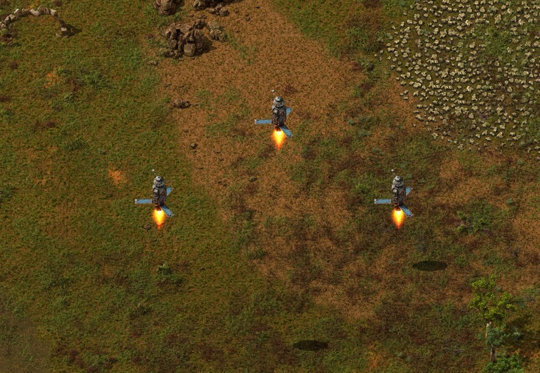
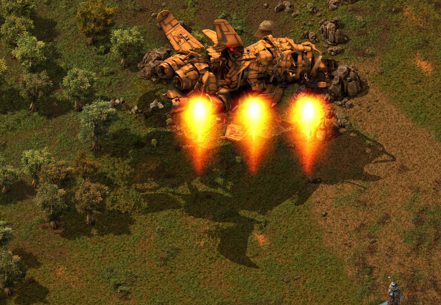
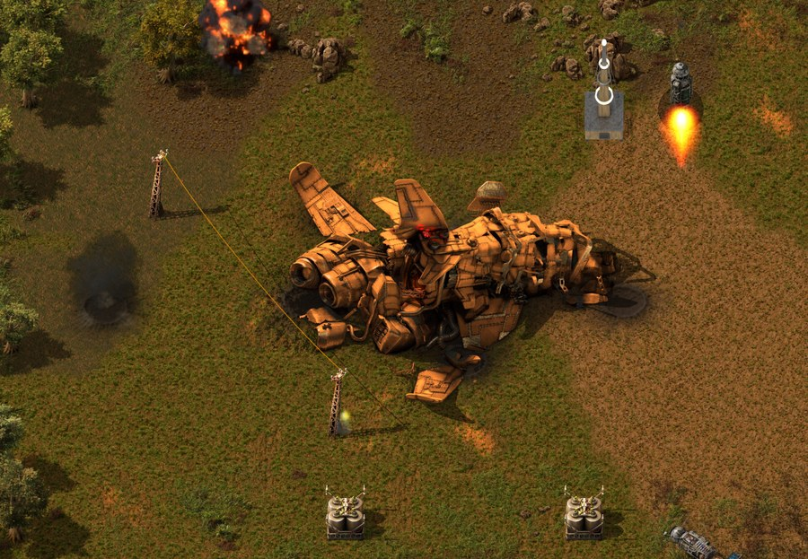

# Arrivals

The factions arrive in a fixed order, each one triggered by something you do. After that they keep landing, grow with
their exports, and match their research to yours. This chapter gives the default timings. The map settings can change
what brings each faction, or keep one away for the whole game (see [Mod settings](reference.qmd#sec-settings)).

## The opening

**Signs.** The first time you own a radar, the wreck of an unknown craft appears  tiles
from it and is charted on your map. It holds electronic circuits and iron gear wheels.

**Survey party.** When you research Oil processing, a Grubstake survey party lands on ore about
 tiles from your spawn: a radar, a few drills, a lamp and guards. Your map marks it
*Survey party*. What you do with it changes when Grubstake arrives:

- Destroy its radar and it drops a command core. Grubstake's arrival then comes
   minutes after your first chemical science pack.
- Leave it and it leaves after  minutes. Grubstake then arrives
   minutes later, whether or not you have made chemical science.

**Grubstake.** Its first camp comes down on your first chemical science pack, or earlier if its survey party left. It
picks a rich ore field away from Kessler-Hayashi, at least  tiles from your turrets and
units.

**Kessler-Hayashi.** It waits for your first rocket launch, then lands within  minutes. It
picks a site with a clear way to your base.

**Synthexis.** Its arrival depends on the biters alone. When the wild biters' evolution on a surface reaches
, a pod comes down on a spawner field with none of your buildings within
 tiles and some within  (out to
 if there is no such field). It prefers fields with many spawners and heavy
pollution, and never lands within reach of your artillery. See [Synthexis](synthexis.qmd).

A faction's first landing is always announced in chat and charted on your map.

**What a landing looks like.** A corporation lands in two steps. First a cargo pod comes down, with an escort pod on
each side. A few seconds later the lander's shadow appears on the ground, and the hull comes down on its thrusters
onto the pad beside them, landing hard in a cloud of dust. Then  cargo pods streak
down around it, one after another, and burst where they land. The pods and the landing are only for show: they damage
nothing and leave nothing behind.

::: {.strip faction="grubstake"}

A Grubstake landing, a few seconds from first to last.
:::

## Landings after the first

The corporations keep landing on a clock. One lands every  minutes, and the corporation
with fewer bases standing lands next. A rocket launch brings Kessler-Hayashi's next landing
 minutes sooner, once between landings.

- At most  bases of each corporation stand at once, its headquarters included.
- A new base lands at least  tiles from every other.
- Each landing brings an escort of  units,  more per
  level of its corporation, and up to  more at full biter evolution. Turrets go up at the
  corners of its landing pad.
- Destroy a corporation's lander and its next landing brings  the escort, unless the
  **Revenge landings** setting is off.

## How the corporations grow

A corporation's bases mine, build parts and send the surplus off-world from their launch pads. The parts it has sent
set its level, and each level unlocks more of what it can do:



**Headquarters.** At level , or after  hours with
 bases standing, a corporation
prepares to build a headquarters. It lands  minutes later, about
 tiles from its richest base. Its lander cannot be destroyed while its uplink stands.

**Withdrawal.** Destroy a corporation's uplink and it withdraws from the planet. It stops building, and its weakest
base falls every  minutes until none is left. The other corporation's next landing comes
 minutes sooner, and you get the withdrawn corporation's prize technology (see
[Spoils](spoils.qmd)).

## The threat curve

The corporations measure your progress by the science you have mastered. A technology's tier is how many kinds of
science pack it takes, and you pass a tier once you have researched % of the
technologies in it. Your *era* is the number of tiers you have passed in a row, from the first:



**Operations at once.** The corporations together can run as many operations against you at once as the table shows,
one more than your era: raids by ground or air, sieges and strip camps. Fights between corporations do not count, and attacks on
your artillery are never held back. A surge or a spree from the headquarters raises the limit by one while it lasts, and their strike
forces come on top of it. With the Director setting off, if none of their operations has come at you for
 minutes, your buildings count for more when they choose a target.

**Research.** Each corporation puts % of its exports into research and buys at most
one item every  minutes. It picks what answers whatever has been killing its units
over the last  minutes: armor against your bullets, anti-air against your
combat robots, heavier lasers against your troopers. It never researches past your era:

- Weapon damage goes up a level at a time, to at most one level more than your era
  ( at most). For most weapons a level adds %.
- New units and abilities each carry an era, and come only once you have reached it.

A corporation that lands late in a game arrives with the research it would have bought by then.

**Kessler-Hayashi armed.** From era , Kessler-Hayashi lands as a walled fortress instead of
a camp, already at level .

**Synthexis** is the exception. Its breeds follow evolution: the wild biters' at first, then its own once its clinic
stands. See [What it breeds](synthexis.qmd#sec-breeds).
