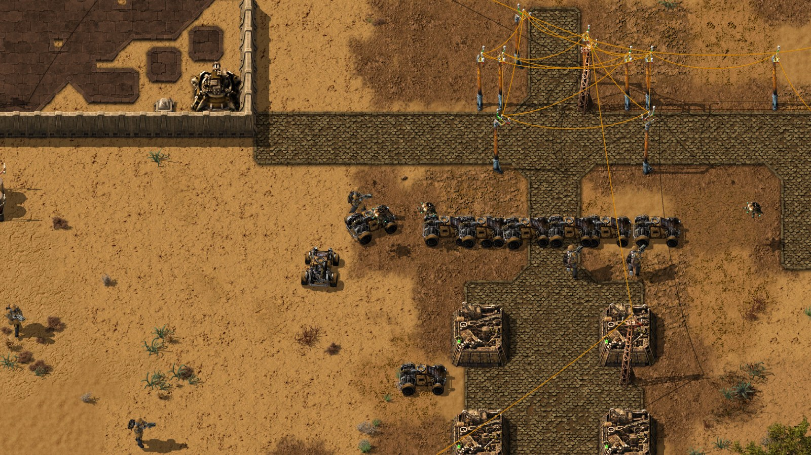

# Grubstake {.opener faction="grubstake" kicker="The corporations"}

::: {.epigraph faction="grubstake"}
:::

::: {.lore kicker="Freight Authority, operator file 209" title="Rights and claims" faction="grubstake"}

::: {.dossier}
GRUBSTAKE INC.
: Commonly "the outfit" at the Authority; "the scrap trade" in Kessler-Hayashi's filings; "the supplier" in
  Synthexis's papers. A partnership under the Articles of Grubstake Inc., "to follow rushes, buy rights and work
  claims".

REGISTERED
: Box 2210, *Clearing House*. No home port; the fleet is the company. Lander hull *Tailings*, survey tender *Assay*,
  both patched, both amber.

PRINCIPALS
: Augustin Pell, Managing Partner (the Articles, every salvage purchase; not on a claim in years). Nadia Szabo,
  Claims Agent, Nauvis. Marit Holm, Night Foreman, Nauvis yard. Dr. H. Ness, field biologist, on contract.

CLAIMS WORKED
: Calder Foundry, Vulcanus, in receivership: the slag heaps and the cranes, bought at the auction and lifted within
  the year. Fulgora, Lot 9, scrap rights for one storm season, sold on when the storms cost more than the scrap.

CLAIMS CURRENT
: Nauvis, the whole of the Register of Claims, Nauvis book, in Szabo's hand. Its camps sit on the richest ore and on
  no ground a gun covers.

LIABILITIES
: The Salvage Convention, article 4, as the company reads it: a machine no gun covers is abandoned, and ore no drill
  works is unclaimed. Three objections lodged by Kessler-Hayashi, none heard.

SEE ALSO
: Kessler-Hayashi (file 114; "the landlord" in Grubstake's books). Synthexis (file 377; a truce, unwritten, kept). The
  Arrangement with the fauna, of which no paper exists.
:::

Grubstake Inc. has an address and no port. Its box at *Clearing House* takes the Authority's post, and what the post
finds there is Augustin Pell's Articles, a partnership "to follow rushes, buy rights and work claims", with the rest of
the company in flight between one claim and the next. Pell has signed every salvage purchase the Registry holds and
has not stood on a claim in years. When the Calder Foundry on Vulcanus went into receivership he bought its slag heaps
and its cranes at the auction, had both off the planet inside the year, and left the receiver a yard swept to the
rock. On Fulgora he held Lot 9 for one storm season and sold the scrap rights on the morning the storms began to cost
more than the scrap.

The company's skill is in its reading of the Salvage Convention. Article 4 lets a salvor take what a failed venture
leaves unattended, and Grubstake reads "unattended" with a generosity the drafters did not intend. A patch of ore no
drill is working is unclaimed ground. A machine that stands where no gun covers it has, in Pell's deposition to the
Authority, been abandoned by an operator who could not be bothered to guard it. Marit Holm runs the Nauvis yard after
dark, and her trucks go out at dusk under headlights and come home at dawn with assemblers in the trunk, taken apart
where they stood and a ghost of each left for the operator's robots to rebuild. A hauler parks beside a belt no turret
reaches and lifts the belt's load, the dearest items first. A buggy strings pylons out to an unguarded pole and clamps
on a tap that the company's books carry as an unmetered connection. The rig that tunnels under the operator's chests
is Holm's too, and the hands that come up through it empty them and go back down.

::: {.pullquote cite="A. Pell, Managing Partner, deposition to the Authority, file 209/2"}
Unattended means unattended. Nowhere does the Convention ask by whom.
:::

Nauvis came onto Pell's list by the oil. The tender *Assay* set down on ore within sight of the operator's first
refinery, with a radar, two drills and a few guards, and Nadia Szabo filed a Notice of Intent to Claim from the ground
before the Registry knew she had landed; *Tailings* brought the first camp down behind it, and the Nauvis book of the
Register has been in her hand since. Each stake she plants carries a lamp that burns amber while the notice runs and
red when it is nearly out, and a patch the operator has not answered by then gets her drills. The camps stand among
the swarm's nests with a fence round the pad and nothing else, which the Authority's inspectors could not account for
until Dr. Ness, the one scientist on the company's payroll, was found to have built an antenna from a gland that keeps
the fauna off anything of Grubstake's. The company calls this the Arrangement. No paper exists, and the waves the
camps' own smoke draws pass them by and fall on the operator. What Grubstake wants it will also buy: a receipt from
its trade post reads "consideration received", and for as long as the consideration lasts, nothing of the operator's
goes missing.
:::

Grubstake is a mining company that lives off your factory. It carries off machines, skims belts, taps power lines, robs
chests and mines the ore you leave alone. It keeps off ground your guns cover, and the wild biters leave it alone. Its
camps, vehicles and lamps are amber.

## Who they are

Grubstake is the first faction you meet, around your first chemical science pack, and it stays to the end of the game
(see [Arrivals](arrivals.qmd)). It starts as your rival, which steals and does not escalate ([Rivals](rivals.qmd)).

## The camp

A camp lands on a rich ore field away from Kessler-Hayashi, at least  tiles from your
turrets and units, spawner fields or not (see [The pact with the biters](#sec-pact)). Its landing pad is fenced, with
the lander in the middle and a pacifier antenna beside it. A grown camp lays streets out from the pad and builds along
them: fabricators, generators, depots, a launch pad, junk yards. Apart from the pad's fence it builds no walls. Its guns
are gun turrets fed with ammunition, alternating with scrap cannons that burst over a group of units. Your gun turrets
outrange both. Its drills pollute more than your electric drills do.

Its army is buggies, shotgun hands and, from its first level, scrap drones. Its haulers, lightly armed trucks, build its
new lots, carry its loot and bring ore home from its claims. Its idle units wait in a yard on open ground outside its
landing pad,  to  tiles from its first depot, on the
side away from your spawn.

- **Grubstake yard.** 

## How it steals

**Thieves' hours.** Its raids on you, its skims and its claim jumps set out only after dark, its trucks lit by
headlights. On a surface with no night, and when it answers your attacks, it comes at any hour.

**The prowl.** Every so often a buggy circles your base just outside your turrets' reach to find outposts and loose
machines. Kill it and the next one keeps clear of that spot.

**Raids.** A raid goes for what no turret covers, by a way round your turrets. At the target its raiders take machines
apart and carry them off with their contents: assemblers, furnaces, drills, labs, solar panels, poles, inserters and
the like. They leave a ghost of each one, so your robots rebuild it at your cost. Walls, turrets, belts, pipes and rails
stay. With nothing left to take, the raid destroys what is there. A larger raid has a foreman, marked with Grubstake's
icon, who carries the haul. Kill the foreman and the raid drops everything and runs home empty. Any other raider killed
drops its own share where it falls.

**Skims.** A hauler parks beside one of your belts that no turret reaches and lifts items into its trunk, the most
valuable first, until the trunk is full, time is up or dawn comes. The tell is the truck and the gaps downstream.

**Strip camps.** A hauler and its guards set up a small mining camp on the ore beside your drills, just out of your
turrets' reach, mine your patch for a while and pack up. Left alone until it is done, a strip camp registers the patch
as claimed. A second one left alone on the same patch stays as a Grubstake outpost.

**Power taps.** A buggy lays a line of Grubstake pylons from the camp to one of your poles that no turret covers, and
clamps a tap beside it.  The draw starts small and rises step by step. Nothing
announces it. You find it in your power statistics, in brownouts, or by its line. Cut the line and the theft stops
until the camp rebuilds the gap. Break the tap and it is over.

**Claim jumpers.** An enemy Grubstake that has gone a while without destroying anything of yours digs a rig in outside
your turrets' reach. Inside your base a mound of dirt grows by your chests, with dust creeping toward it from the rig.
After  minutes shotgun hands come up through it, empty the chests nearby, break what stands
close and go back down. Kill the rig before then and nothing comes up. Kill it after and the tunnel caves in, leaving
the hands to fight.

**The howitzer.** Only a camp that lands with a grudge, after you destroyed one of its landers, besieges your walls.
Against a wall kept mended by robots, it brings a howitzer on a truck to shell your roboports from far out.

## Claims and the trade post

**Prospecting.** A grown camp picks the charted ore patch nearest your base that none of your drills works, tags it on
your map (*Mineral rights reassigned*) and sends a buggy to plant a claim stake there.
 The stake's lamp burns amber, then red and blinking as time runs out.
 minutes after it is planted, a hauler builds a claim: a generator, a pylon and
drills with ore bins. To keep the patch, put a drill on it, set a claim marker by it or destroy the stake (or the buggy
on its way). The camp then moves on to the next patch, one at a time, under any standing.

::: {.callouts plan="media/plans/grubstake-claim.json" faction="grubstake" width="0.82"}
A claim on a patch Grubstake staked, as its hauler built it. The stake is gone once the claim stands.
:::

**The road.** A claim has no power line or belt to the camp. Haulers empty its bins and drive the ore home, and one
killed on the way spills its ore. A claim with no ore reaching home for a while lapses, so the camp stops rebuilding it
and its drills are yours to capture.

**The trade post.** You can build one from the start.  Once it holds enough, the
nearest camp sends a hauler for it, and what the goods are worth sets the length of the truce. While it lasts, its lamp
is lit and Grubstake sends no raid, skim, strip camp or claim jumper at you and lays no new tap. If the hauler is
destroyed on its way home, by you or by Kessler-Hayashi, there is no truce and the goods spill.

## The pact with the biters {#sec-pact}

While any of Grubstake's pacifier antennas stands, it and the wild biters hold fire on each other (the Arrangement,
in its own books). It lands among
spawners and marches its raids through them, and for you and Kessler-Hayashi the biters round its camps are a wall.

**Under the pact the waves fall on you.** The attacks its drills' pollution draws pass its camp by and go for your
polluting buildings near its cloud. Its pollution also feeds [Synthexis](synthexis.qmd).

**Breaking it.** The pact is the whole corporation's. Destroy every pacifier and it breaks for every camp, and the biters
nearby turn on them at once. A camp rebuilds its pacifier  minutes after losing
it, while its lander stands, and the pact holds again.

- **Pact breaker.** 
- **Pheromone bait.**  With the pact down, it sets the biters on a Grubstake camp.

## Research

Grubstake researches as the other corporations do, answering what has been killing its units and never going past
your era (see [Arrivals](arrivals.qmd)). Its units are in the [Reference](reference.qmd#sec-units).

- **Scrap arms.** Damage for its bullets and shells, scrap plating against your bullets, asbestos against your fire.
  Slug buggies against your vehicles, dynamite sappers against your troopers, flame tanks against turret lines.
- **Wheels.** Flak buggies against fliers and combat robots, bomb drones (they go for artillery, mortars and radars)
  against your explosives, dozers once its raids keep meeting walls.
- **Loot.** Salvage rights, once its raids have been turned back: what it destroys of yours funds its research.
  Prospector's eye: its strip camps reach further for your ore and its raiders retreat sooner.

## Its units {#sec-gs-units}

A camp lands with buggies and shotgun hands, and its scrap drones come with its first level. The rest is research, done in
no lab you can raid.

::: {.tree tree="grubstake-units"}
Each node is bought with parts once its trigger has fired, which is when what it answers has cost Grubstake enough.
A node's era is yours, and none comes before you reach it. Dashed nodes are armor and abilities, not units.
:::



## Fighting Grubstake

- **Cover what you own.** A turret by an outpost, a belt or a power line sends its raids, skims and taps elsewhere.
- **Kill the foreman.** The raid drops its whole haul and runs.
- **Hunt the haulers.** Each one killed spills what it carries, and claims without ore coming home lapse.
- **Raid the yard** to get your goods back.
- **Break the pact,** then bait the biters onto its camps.
- **Mind its standing.** Hurt it and it raids with more. Destroy a lander and its next landing comes angry. Destroy its
  uplink and it withdraws, and you get its prize, the strip drill (see [Arrivals](arrivals.qmd)).

**Field studies.** Destroying its raiders or a hauler teaches you the claims register, its drills the strip drill, a
pacifier the made pheromone bait, a scrap cannon or its fliers the flak turret. See [Spoils](spoils.qmd).
