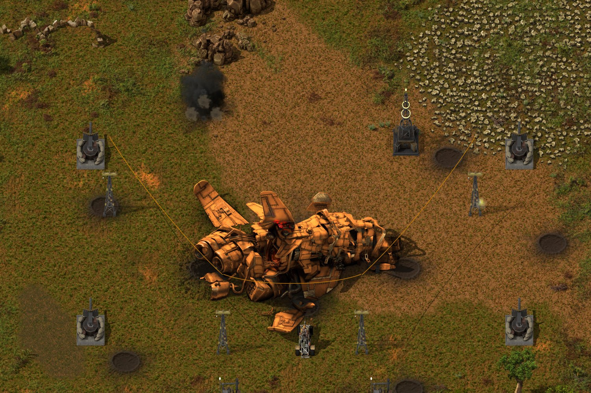

# Grubstake {.opener faction="grubstake"}

::: {.epigraph faction="grubstake"}
:::

::: {.lore title="The prospectors" faction="grubstake"}

Grubstake Inc. goes wherever there is a rush. Its crews are prospectors, scrappers and hired guns who signed on for a
share, and the company has no home but its ships, the lander *Tailings* and the survey tender *Assay*. Augustin Pell,
its managing partner, runs it from a mail box at *Clearing House* and has signed every deal it has made.

When the Calder Foundry on Vulcanus went bankrupt, Grubstake bought it and stripped it to the rock. On Fulgora it
worked a season of scrap rights and sold them on when the storms got worse.

Nauvis has untouched ore fields, and a factory full of machines in the middle of them. Grubstake stakes claims on the
ore nobody is mining. For the factory, Pell points to the Salvage Convention: a machine left unattended is abandoned,
and abandoned property belongs to whoever takes it.

Grubstake does not want a war. Nadia Szabo files its claims on Nauvis, and Marit Holm sends its crews out at night to
take what nobody is guarding. Its camps sit among the biter nests with barely a fence, and the swarm leaves them alone;
Dr. H. Ness, the company's biologist, has not said why. A payment at its trade post keeps its trucks at home for a
while.

::: {.pullquote cite="A. Pell, Managing Partner"}
If you wanted it, you would have guarded it.
:::
:::

Grubstake is a mining company that lives off your factory. It carries off machines, skims belts, taps power lines, robs
chests and mines the ore you leave alone. It keeps off ground your guns cover, and the wild biters leave it alone. Its
camps, vehicles and lamps are amber.

## Who they are

Grubstake is the first faction you meet, around your first chemical science pack, and it stays to the end of the game
(see [Arrivals](arrivals.qmd)). It starts as your rival: it steals from you but does not escalate (see
[Rivals](rivals.qmd)).

## The camp

A camp lands on a rich ore field away from Kessler-Hayashi, at least  tiles from your
turrets and units, whether or not there are biter spawners nearby (see [The pact with the biters](#sec-pact)). Its
landing pad is fenced, with the lander in the middle and a pacifier antenna beside it. A grown camp lays streets out
from the pad and builds along them: fabricators, generators, depots, a launch pad, junk yards. Apart from the pad's
fence it builds no walls. Its defenses are gun turrets, alternating with scrap cannons whose shells burst over groups
of units. Your gun turrets outrange both. Its drills pollute more than your electric drills.

Its army is buggies, shotgun hands and, from its first level, scrap drones. Its haulers, lightly armed trucks, build its
new lots, carry its loot and bring ore home from its claims. Its idle units wait in a yard on open ground outside its
landing pad,  to  tiles from its first depot, on the
side away from your spawn.

- **Grubstake yard.** 

## How it steals

**Night work.** Its raids, skims and claim jumps set out only after dark, its trucks running with headlights. On a
surface with no night, or when it is retaliating, it comes at any hour.

**Scouting.** Every so often a buggy circles your base just outside turret range, looking for outposts and unguarded
machines. If you kill it, the next one keeps away from that spot.

**Raids.** A raid targets what no turret covers, and takes a route around your turrets. At the target its raiders take
machines apart and carry them off with their contents: assemblers, furnaces, drills, labs, solar panels, poles,
inserters and the like. They leave a ghost of each one, so your robots rebuild it at your cost. Walls, turrets, belts,
pipes and rails are left alone. When there is nothing left to take, the raid destroys what is there. A larger raid has
a foreman, marked with Grubstake's icon, who carries the haul. Kill the foreman and the raid drops everything and runs
home empty-handed. Any other raider drops its own share where it is killed.

**Skims.** A hauler parks beside one of your belts that no turret reaches and lifts items into its trunk, the most
valuable first, until the trunk is full, its time is up or dawn comes. You can spot a skim by the truck, and by the
gaps on the belt downstream.

**Strip camps.** A hauler and its guards set up a small mining camp on the ore beside your drills, just out of your
turrets' reach, mine your patch for a while and pack up. If a strip camp finishes undisturbed, the patch is registered
as Grubstake's claim. If a second one finishes on the same patch, it stays as a Grubstake outpost.

**Power taps.** A buggy lays a line of Grubstake pylons from the camp to one of your poles that no turret covers, and
clamps a tap beside it.  The draw starts small and rises step by step. There is no
warning: you find it in your power statistics, through brownouts, or by following its line. Cutting the line stops the
theft until the camp repairs it; destroying the tap ends it.

**Claim jumpers.** When an enemy Grubstake has gone a while without destroying anything of yours, it sets up a digging
rig outside your turrets' range. Inside your base, a mound of dirt grows next to your chests, with a trail of dust
leading to it from the rig. After  minutes, shotgun hands come up through the mound,
empty the chests nearby, break what stands close and go back down. Destroy the rig before then and nothing comes up.
Destroy it after, and the tunnel collapses with the hands still on your side.

**Sieges.** Only a camp that landed with a grudge, after you destroyed one of Grubstake's landers, besieges your
walls. Against a wall your robots keep repairing, it brings a howitzer on a truck to shell your roboports from long
range.

## Claims and the trade post

**Prospecting.** A grown camp picks the charted ore patch nearest your base that none of your drills is mining, marks
it on your map (*Mineral rights reassigned*) and sends a buggy to plant a claim stake there.  The stake's lamp burns amber, then turns red and blinks as time runs out.  minutes after it is planted, a hauler builds a claim: a generator, a pylon and
drills with ore bins. To keep the patch, put a drill on it, place a claim marker by it, or destroy the stake (or the
buggy on its way). The camp then moves on to the next patch, one at a time, whatever its standing with you.

::: {.callouts plan="media/plans/grubstake-claim.json" faction="grubstake" width="0.82"}
A claim on a patch Grubstake staked, as its hauler built it. The stake is removed once the claim is built.
:::

**The road.** A claim has no power line or belt to the camp. Haulers empty its bins and drive the ore home, and a
hauler killed on the way spills its ore. A claim that has sent no ore home for a while lapses: the camp stops
rebuilding it, and its drills are yours to capture.

**The trade post.** You can build one from the start.  Once it holds enough, the
nearest camp sends a hauler for it, and what the goods are worth sets the length of the truce. While it lasts, its lamp
is lit and Grubstake sends no raid, skim, strip camp or claim jumper at you and lays no new tap. If the hauler is
destroyed on its way home, by you or by Kessler-Hayashi, there is no truce and the goods spill.

## The pact with the biters {#sec-pact}

While any of Grubstake's pacifier antennas stands, Grubstake and the wild biters leave each other alone. It lands
among spawners and sends its raids through them, while you and Kessler-Hayashi have to fight through the biters around
its camps.

**The biters attack you instead.** Attacks drawn by its drills' pollution pass its camps and go for your polluting
buildings near its cloud. Its pollution also feeds [Synthexis](synthexis.qmd).

**Breaking it.** The pact covers the whole corporation. Destroy every pacifier and it breaks for every camp, and the
nearby biters attack them at once. A camp rebuilds its pacifier  minutes
after losing it, as long as its lander stands, and the pact holds again.

- **Pact breaker.** 
- **Pheromone bait.**  With the pact down, it sets the biters on a Grubstake camp.

## Research

Grubstake researches as the other corporations do, answering what has been killing its units and never going past
your era (see [Arrivals](arrivals.qmd)). Its units are in the [Reference](reference.qmd#sec-units).

- **Scrap arms.** Damage for its bullets and shells, scrap plating against your bullets, asbestos against your fire.
  Slug buggies against your vehicles, dynamite sappers against your troopers, flame tanks against turret lines.
- **Wheels.** Flak buggies against fliers and combat robots, bomb drones (they go for artillery, mortars and radars)
  against your explosives, dozers once its raids keep meeting walls.
- **Loot.** Salvage rights, once its raids have been turned back: what it destroys of yours funds its research.
  Prospector's eye: its strip camps reach further for your ore and its raiders retreat sooner.

## Its units {#sec-gs-units}

A camp lands with buggies and shotgun hands, and gets scrap drones at its first level. Everything else is researched,
with no lab you can raid.

::: {.tree tree="grubstake-units"}
A node can be bought with parts once what it counters has cost Grubstake enough. Eras are yours: no node comes before
you reach its era. Dashed nodes are armor and abilities, not units.
:::



## Fighting Grubstake

- **Cover what you own.** A turret by an outpost, a belt or a power line sends its raids, skims and taps elsewhere.
- **Kill the foreman.** The raid drops its whole haul and runs.
- **Hunt the haulers.** Each one killed spills what it carries, and claims without ore coming home lapse.
- **Raid the yard** to get your goods back.
- **Break the pact,** then bait the biters onto its camps.
- **Watch its standing.** Attack it and it raids in greater numbers. Destroy a lander and its next landing comes
  angry. Destroy its uplink and it withdraws, and you get its prize, the strip drill (see [Arrivals](arrivals.qmd)).

**Field studies.** Destroying its raiders or a hauler teaches you the claims register, its drills the strip drill, a
pacifier the made pheromone bait, a scrap cannon or its fliers the flak turret. See [Spoils](spoils.qmd).
