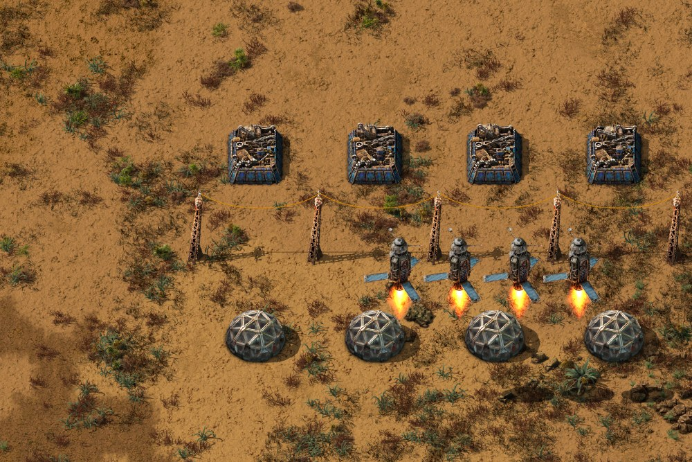
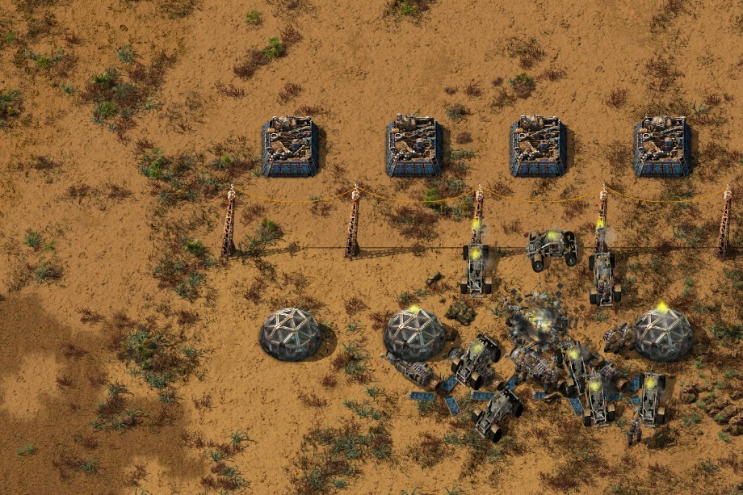
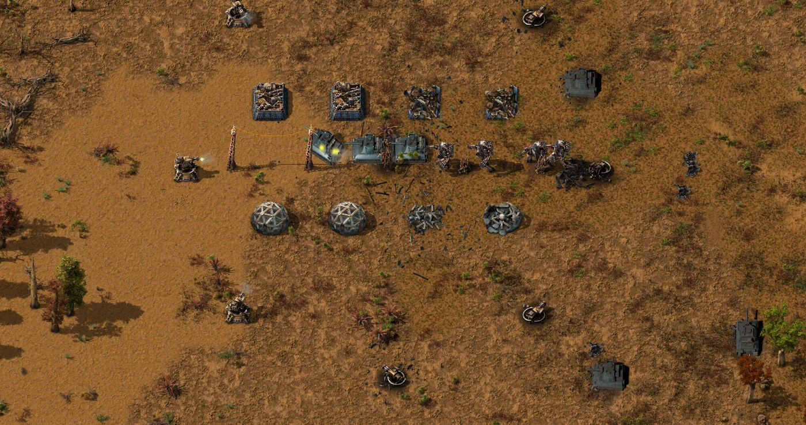
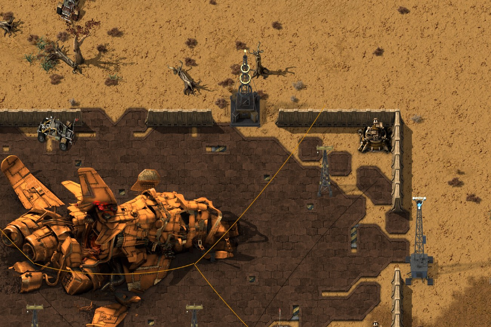
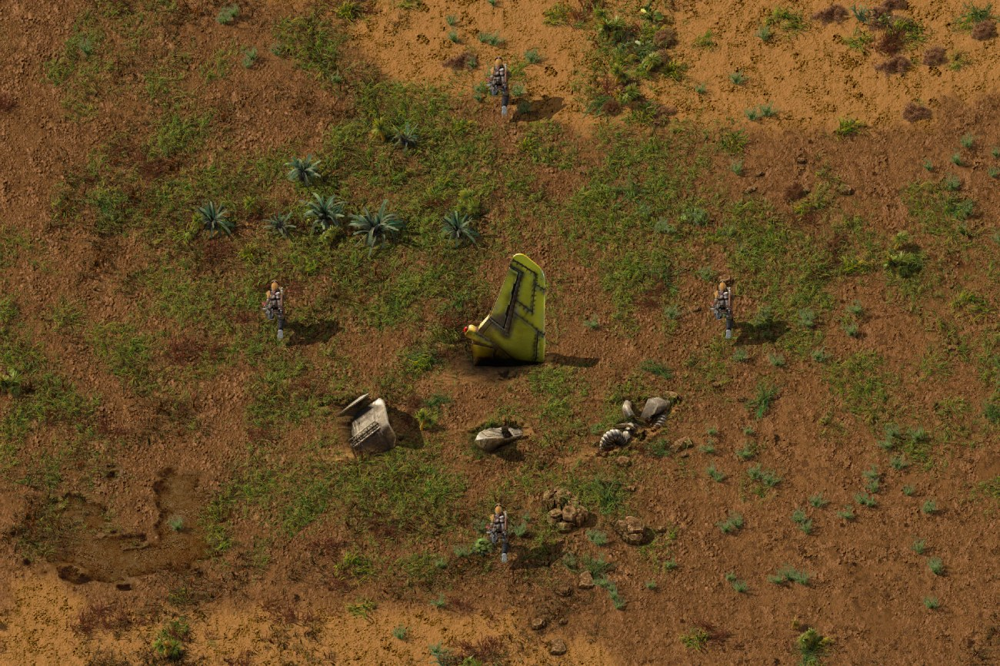
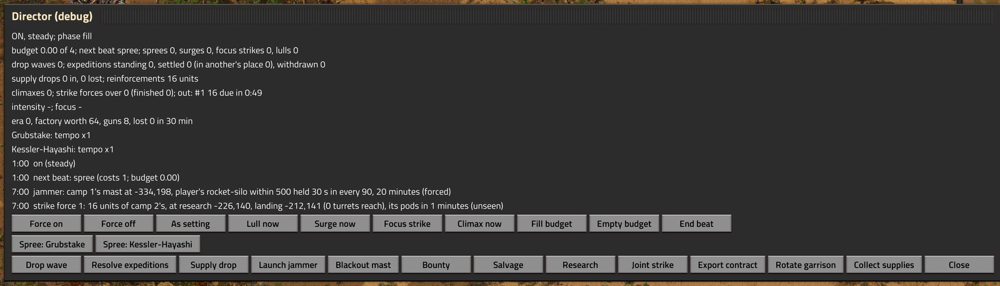

# Headquarters

The camps on Nauvis are not left to themselves. Each corporation's headquarters watches the planet from orbit and sets
the pace of its war on you: when its camps press, when they hold back, and what it sends down itself. It begins
 minutes after the first corporation lands. The **Director** setting chooses how it plays,
or turns it off (see [Settings](#sec-director-settings)).

::: {.lore title="The offices in orbit"}

No company runs a war from the ground. Kessler-Hayashi keeps its staff on a command platform in high orbit, among the
freighters it escorts, and sends its camps their orders by beam. Grubstake has no fixed office. Its partners meet on
whichever of its ships is nearest the latest rush and settle their accounts there.

Both keep reserves in orbit for the work a camp cannot do alone: troops for a raid in force, crates of parts for a
camp in trouble, masts and survey gear. Both also keep a ledger of the engineer's factory, with a value on
each of its buildings.
:::

## The pace of the war

Pressure on you comes and goes. For a while one corporation attacks more often than usual, for
 minutes. At other times every corporation at war with you steps up at once, for
 minutes, and sometimes all their camps go for the same part of your base. After a
hard stretch, the corporations that caused it hold their attacks for up to  minutes,
and their units out in the field walk home without fighting.

None of this is announced. You see it only in the attacks themselves.

When every corporation steps up at once, a raid that gets into your base without meeting resistance does not stop at its target. It moves on
to the next undefended building nearby, and the next.

## Strike forces

The largest attacks come from headquarters itself, and every step-up brings one. A strike force comes down by drop
pod, not out of a camp's garrison. Its size follows the worth of your factory, up to 
units at normal difficulty. The difficulty setting scales it from there, and it grows while you go a long time without
losses. The largest strike forces bring  that.

**Where it lands.** Its pods come down within  tiles of its target, at the spot the
fewest of your turrets can reach. That is usually inside your walls.

**What it goes for.** A strike force has a reason for its target.

- First, revenge. If one group of your guns has killed  of a corporation's units in the
  last  minutes, its next strike force lands beside them. Guns within
   tiles of each other count together. If your army did the killing, it goes for
  the nearest barracks.
- Otherwise, what its corporation wants. Grubstake goes for your power and for the offshore pumps that feed your
  boilers. Kessler-Hayashi goes for your rocket silos, cargo landing pads and labs. Either may go for a train station,
  a roboport, oil processing or your army's barracks.
- Rarely, while you are on the planet in person, it comes for you. A strike force sent after the engineer follows
  your character wherever you go.

Its units are chosen for the job. A strike force brings what beats the units and guns that have been killing its
corporation's troops, and what beats the turrets and units within  tiles of its
target.

**Warning.** You are told when it lands, with an alert and a marker on the map. If your radars cover the spot where
its pods will come down, you are told ahead, with the place:  minutes with a radar right
over the spot ( for the largest), less the further the spot lies from the nearest
radar, down to  seconds at the edge of its reach. A strike at your power or at the pumps feeding your boilers
is always told ahead, with its target named and marked on the map. It comes only while you are on the planet in
person, and while it is out no other attack on you starts, nor for  minutes after.

**In the field.** It fights for  minutes, going from its target to whatever of
yours is nearest. Once it has lost % of the units that landed, it breaks and
walks home. It goes round your turrets where it can, and turns only on what is shooting at it.

**Going home.** There is no lift off the planet without a rocket, so a strike force walks back to its camp. There its
survivors join the garrison if the camp has room, and the rest leave on the camp's rocket. Survivors you let go make a
camp stronger. Units still on the road after  minutes join the camp where they stand.

**Beating one.** Turrets alone rarely save the target, since the pods land where they reach least. An army waiting
where the pods come down can save it, and radar warns you in time to send it there. A squad that arrives after the pods have opened
can still break the force and hunt it down on its way home, but by then the target is usually gone.

## Masts

A camp can raise a mast that works on your factory from a distance. Each one stands in its camp, marked on your map,
and stops working when you destroy it.

- **Launch jammer.** A Kessler-Hayashi camp within  tiles of a rocket silo of yours
  raises a jammer. Every silo in its reach stops for  seconds, runs for
  , and stops again, for  minutes.
- **Blackout mast.** A Grubstake camp raises a mast that shuts down your radars within
   tiles for  minutes. While they are dark,
  strike forces land without warning.

## The bounty

A corporation's headquarters may put a price on one of your most valuable buildings: a machine, a generator, a lab, a
silo, a roboport or a radar. It is marked on your map as that corporation's bounty. For
 minutes, or until it falls, every camp of that corporation goes for it, and a
strike force is sent at it. The camp whose units destroy it is paid in parts.

## Salvage

During some of the quiet stretches, a rival shuttle crashes about  tiles from
your spawn. It happens only while you are on the planet in person, never with another wreck still lying uncollected,
and less often as the game goes on. The wreck is marked on your map and raises an alert.

It holds a load of materials that grows with your progress, and one piece of equipment whose quality is left to
chance. Survivors of the crew guard it. If you leave it  minutes while a guard still
stands, their corporation takes it for parts and the guards go home. A wreck left unguarded is gone after
 minutes.

About  of the wrecks also carry a data core. Empty such a wreck and the target of the
next strike force is marked on your map as soon as it is chosen.

## Other orders from headquarters

- **Drop wave.** A corporation lands  camps at once. Each stays
   minutes on trial. It then settles if its corporation has room for another
  camp, or takes the place of the corporation's weakest camp if it has exported more and you have not attacked that camp
  in  minutes. Otherwise it leaves.
- **Supply drop.** A crate of parts comes down by pod for the poorest camp at war with you, between that camp and your
  base, and is marked on your map. If the crate still stands  minutes later, the camp
  has its parts. Destroy it first, or take the iron plates inside.
- **Research breakthrough.** A corporation buys its next research at once. Its new units are the only sign.
- **Joint strike.** Two corporations each send a strike force of % the usual size
  at one target, and both land together.
- **Export contract.** A corporation's camps stop attacking you for  minutes and
  work for a client off the planet, a beam rising from each camp's pad. Each camp is marked on your map while the
  contract runs. Every camp you
  leave alone through it is paid at the end, so attacking one in that time keeps it weaker.
- **Garrison rotation.** A camp sends up to  of its units off on its rocket and gets
  as many back by pod  minutes later. The camp is marked on your map as rotating,
  and until the pods come back it has fewer units than before.

## What you are told

Even with **Chat notices** off, you are told of every strike force as it lands or as your radar sees it coming, of a
strike at your power, and of drop waves and supply drops. The quiet stretches and the step-ups are never announced.

## Settings {#sec-director-settings}

The **Director** map setting chooses how headquarters plays:

- **Steady**, the default, as described above.
- **Gentle** builds up  as fast, keeps its quiet stretches longer, and makes only
  step-ups: none of the other orders in this chapter.
- **Chaotic** makes step-ups, converging attacks and drop waves, weighed alike, and waits a random while before each
  one, so its gaps are longer and its moves bigger when they come. It gives none of the other orders.
- **Off** leaves each camp to fight on its own.

The **Difficulty** setting scales the size of strike forces as it scales everything else. The `/lp director` command
opens a panel that shows what headquarters is doing and can order any of these moves at once, for trying them out (see
[Chat commands](reference.qmd#sec-commands)).

