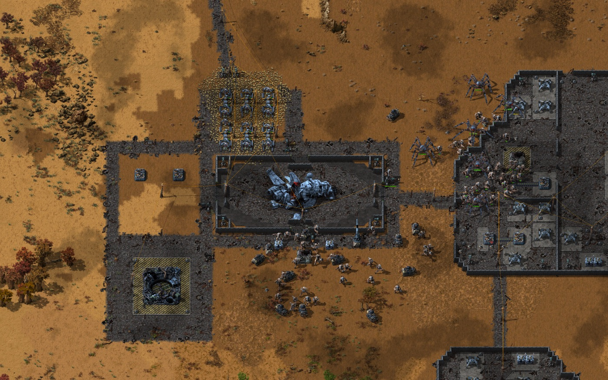

# Kessler-Hayashi

> Please remain behind the line.

Kessler-Hayashi is a security contractor. It lands late and is at war with you from the day it arrives. It walls its
camp in and moves a line of posts out toward your base, and its sieges go at whatever stands in the way. It plans from
orbit: it knows your defenses before it sets out.

## Who they are

Kessler-Hayashi waits for your first rocket launch, then lands on a site with a clear way to your base (see
[Arrivals](arrivals.qmd)). From era  it lands armed: a walled fortress whose sieges call
orbital strikes and stay until you break them.

Its army is troopers, tanks and railgunners, with laser drones from its second level. The railgunners clear the biter
spawners round its camp. Full numbers are in the [Reference](reference.qmd#sec-units).

It raids what your turrets do not cover, and it cuts power: it finds the pole that feeds the turrets facing it with no
second feed, and destroys it where no turret reaches. Its sieges are its main weapon (see [Sieges](#sec-kh-sieges)).
Anything you build on its ground, or a turret you put up by its camp, is answered with one. Only a truce bought at its
invoice post makes it stop for a while.

## The camp and the line

A camp is floored with space platform foundation. Each hub stands inside its own wall, with a gate in every opening, a
second wall behind each gate, turrets in walled corner pillboxes and flamethrower turrets at the gates.

- **Lander.** It cannot be destroyed while at least half of the generators round it stand. Generators are not military
  targets: your turrets and units do not fire on them by themselves. Its crews rebuild lost generators first.
- **Dome projector.** 
- **Parked howitzer.** It stands by the lander. When its spot is empty, a siege has it out.

**The dome.** While the lander holds, a dome stands within  tiles of it, and each hub
after the first has a projector with a dome over its blocks. A dome catches every artillery shell fired from the ground
that enters it, including shells on their way to something behind it: a bolt from the projector hits the shell, and a
wave runs across the bubble. Units, bullets, lasers and orbital strikes pass through. It holds for
 minutes of fire from all the artillery that reaches it, however many guns, then breaks
for  minutes. When a dome comes up again, a ripple spreads from its projector to its
edge. Destroy half the generators round the lander and every dome of that camp goes down (a headquarters answers to its
uplink instead). A destroyed hub projector is put back after  minutes.

**The line.** From  minutes after landing, the camp's claim steps
 tiles outward every  minutes, up to
 tiles from the camp, toward the outpost of yours easiest to cut off. Each step is an
arc of posts its drones build first: a concrete pad, a short wall facing you and two gun turrets. Near your buildings
the arc's middle is closed with wall; across your straight rails it puts gates, and your trains stop there. A warning
names the building of yours the next step will enclose. Once enclosed, that building is worth double to its raids and
sieges.

Where its turrets stand, the line blows up your belts and pipes that cross its edge. Underground belts and pipes whose
ends stand off the line pass. Destroy the posts of one stretch and the line stays open there for a while.

## Sieges {#sec-kh-sieges}

Kessler-Hayashi mounts sieges from its first level. Its guns come down from orbit, so there is no truck to stop.

1. The escort marches out and stops just outside your guns' reach, in staggered ranks spaced so one shell cannot catch
   many.
2. A cargo pod lands on each gun's spot, and the gun is assembled where it lands, sparks flying. The site reads
   *Deploying* for  seconds.
3. Its mortars, just outside your turrets' reach, shell one point at a time, your roboports first.
4. When nothing is left in reach, or right after an orbital strike, the escort goes in rank by rank, for the roboports
   near the breach and then its target. After heavy losses it falls back, and its guns move up and drop again.

A siege ends when its guns are destroyed or its shells run out. An armed camp's siege does not leave on a clock: pods
bring it more shells.



**The howitzer.** Where roboports cover the target, the siege brings a howitzer to reach the roboports behind your wall.
Your artillery outranges it and fires on it by itself. Destroy it and that camp goes without one for
 minutes.

**Kessler-Hayashi jamming mast.** It goes up with the howitzer and destroys your construction and logistic robots within
 tiles, so the breach stays open. Your threat scanners in its reach read nothing.

**The orbital strike.** Once an armed camp's mortars are up, it calls one strike on the first of your walls or turrets
on the way to its target. A spotter, the escort member nearest that point, paints it for
 seconds: a red beam, rings closing on the point, and a beam of light from the spotter into
the sky. The orbital platform's shadow passes over. Then lances fall on the point, outward along the wall, and on each
of your turrets that covers the gap, and the escort goes in behind them. Kill the spotter while it paints and the strike
is called off. A standing siege calls another after  minutes. Domes do not stop it,
theirs or yours.



**The site dome.** Once an armed camp's siege starts shelling, a dome projector goes up by its guns. Its dome catches
your artillery shells as a camp's does, and moves with the siege.

## The invoice post and truces {#sec-kh-invoice}

Biters attack Kessler-Hayashi too. When a camp has tried to clear the spawners they come from, and those spawners sit in
your pollution with one of your drills, furnaces, assemblers or boilers within reach, it bills you for its losses,
every  minutes while they go on.

**Invoice post.**  It stands on the line toward your base, with the sum owed over
it in electronic circuits. Each billed spawner is marked with Kessler-Hayashi's icon, in game and on your map.

- **Paying.** Put items in the post. It takes circuits, modules, steel and other valuable intermediates by their worth,
  up to what is owed. Paid off, the bill buys one minute of truce for every  electronic
  circuits' worth paid since the last truce.
- **Disputing.** Destroy a billed spawner yourself while its bill is open and its sum is struck off. With nothing left
  owed, the post comes down.
- **Ignoring it.** Nothing changes: Kessler-Hayashi is at war with you already.

A truce covers every Kessler-Hayashi camp: no raids, sieges or cuts, and the line holds. It is also the only time
Kessler-Hayashi accepts a border stake. The border then holds after the truce ends, until you build on its side.

## Research {#sec-kh-research}

Kessler-Hayashi researches as the other corporations do (see [Arrivals](arrivals.qmd)), in labs you can see and
destroy. Each branch has its own, at the heart of a walled district:

- **Optics lab.** Laser damage, heavy laser troopers, shock troopers and laser tanks.
- **Armory.** Armor for its troopers, anti-air troopers and heavy tanks.
- **Siege works.** Railgun damage, dug-in siege sites, shock troopers against your artillery, and lightning tanks.

A branch advances only while one of its labs stands in some Kessler-Hayashi camp. Destroy the last one and the branch
stops: its units are no longer built and its armor and siege abilities are off. Damage levels already researched stay.
Its crews rebuild the lab like any building. Labs are military targets.

## Fighting Kessler-Hayashi

- **Cut the lander's power.** Its generators hold the lander and every dome of the camp. Aim at them yourself, and press
  on before its crews rebuild them.
- **Walk under the dome.** It stops shells only.
- **Kill the spotter.** Turrets that cover the ground just outside your wall often get it during the paint.
- **Target the mortars by hand.** A siege's mortars are not military targets, so your artillery leaves them alone.
  Use the artillery targeting remote. Against a site dome, send troops or destroy its projector first.
- **Kill the howitzer and the mast.** Without the howitzer your roboports behind the wall are out of reach, and without
  the mast your robots mend the breach.
- **Give your turrets a second feed.** A cut needs a pole with nothing behind it. Accumulators by the turrets keep them
  firing through one.
- **Use a field dome.**  It does not stop the orbital strike.

**When a camp gives up.** A camp stands down after  of its operations against you fail in
a row, or after  minutes without destroying anything of yours. The
**Kessler-Hayashi: aggression** setting scales both. Stood down, it sends nothing at you and keeps its army to
% of its usual size. It still defends its ground: a turret you put up there is
answered. A new landing comes within  minutes, away from it, and after
 minutes the camp starts again.
