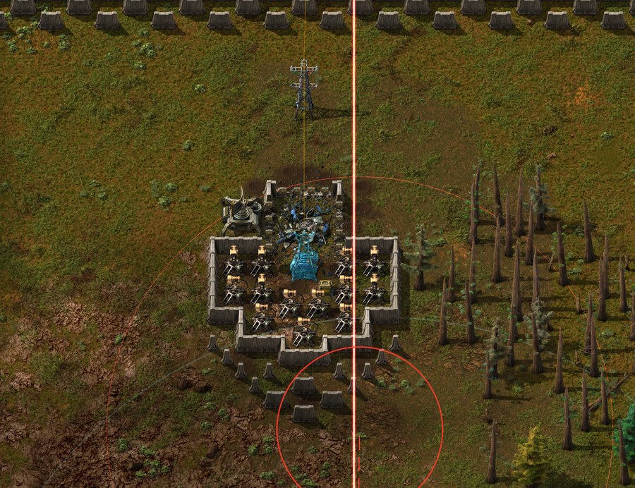
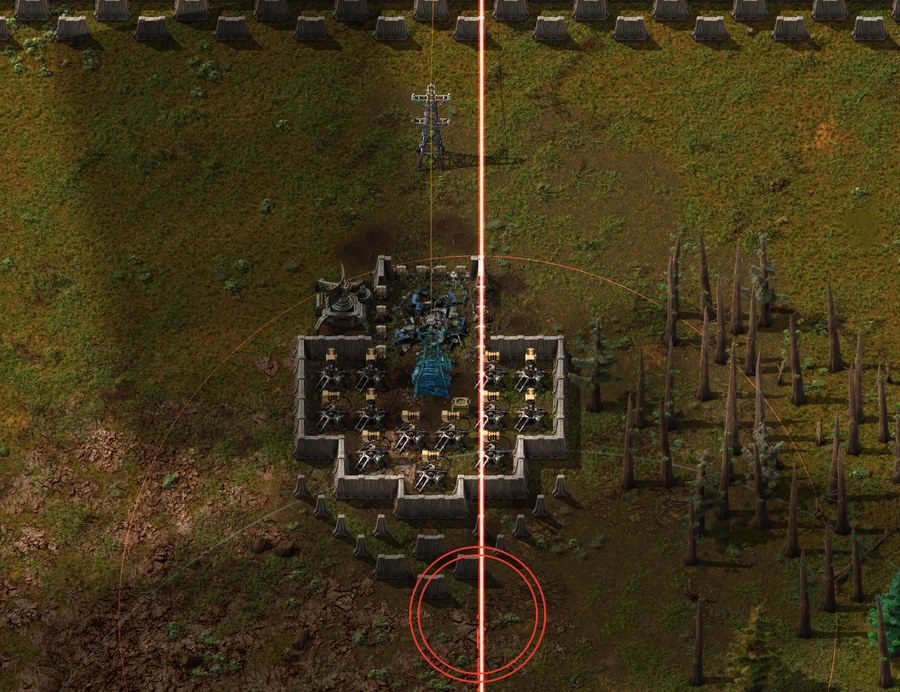
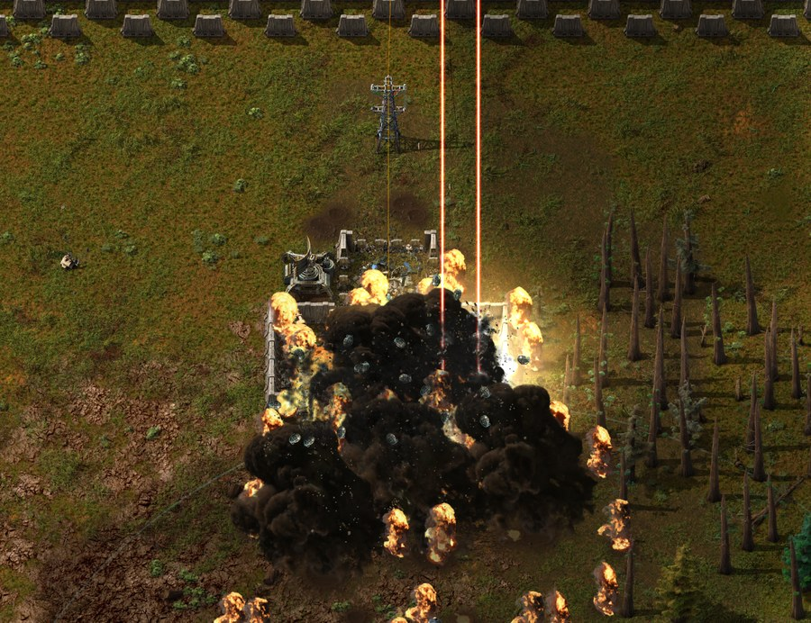

# Kessler-Hayashi {.opener faction="kessler-hayashi"}

::: {.epigraph faction="kessler-hayashi"}
:::

::: {.lore title="The contractor" faction="kessler-hayashi"}

Kessler-Hayashi is two companies joined. Hayashi Lane Assurance insured cargo on the inner lanes, and Kessler Escort
ran gunships on the long run to Aquilo. When raids on that run cost Hayashi more than it could pay out, it bought
Kessler instead of paying, and the merged company kept both names. Today it is a listed conglomerate that answers to a
board and its shareholders, with divisions for assurance, freight, security and survey. It escorts freighters and
guards the foundries on Vulcanus, but owns no land anywhere. Its people live on the Serenity Ring, a station of armed
platforms in orbit, and go down to a planet only when a contract sends them.

Contract NV-1 sends the Security Division to Nauvis. A client the company will not name has paid it to guard the
engineer's launch lanes and any cargo that leaves the surface. Ilse Varga, Director of Field Operations, treats the
engineer as an armed, unlicensed operator inside the contract zone. Her camps hem the engineer in with guard posts,
and Tomas Adeyemi, Chief of Siege Works, plans sieges on whatever stands in their way, working from the platforms'
pictures of the engineer's defenses.

::: {.document head="Kessler-Hayashi · Office of the Board"}
**To:** Ilse Varga, Director of Field Operations, Nauvis\
**Re:** Contract NV-1

The Nauvis contract has now cost the Security Division more than it has earned for three quarters running. The board
expects these losses to be recovered from the operator wherever the contract allows, beginning with personnel lost to
the natives.

The Survey Division will continue its work at every camp on its own budget. Its findings are the property of the
company and are not to be shared with the client.

*For the Board*
:::
:::

Kessler-Hayashi is a security contractor. It lands late and is at war with you from the day it arrives. It walls its
camp in and moves a line of posts out toward your base, and its sieges go at whatever stands in the way. It plans from
orbit, so it knows your defenses before it sets out.

## Who they are

Kessler-Hayashi waits for your first rocket launch, then lands on a site with a clear way to your base (see
[Arrivals](arrivals.qmd)). From era  it lands armed: a walled fortress whose sieges call
orbital strikes and stay until you break them.

Its army is troopers, tanks and railgunners, with laser drones from its  level. The railgunners clear the biter
spawners round its camp. Full numbers are in the [Reference](reference.qmd#sec-units).

**Clearing nests.** A camp that the biters keep attacking sends a clearance to the nests they come from. Its guns come
down in cargo pods, with a howitzer where worms outrange the mortars, and its railgunners go in once the shelling is
done. The further the biters have evolved, the more railgunners it sends. The site digs in the moment it lands: a ring
of wall, pillboxes facing the nests, and, once the biters are well evolved, a flamethrower turret in the middle. Late
in the game its gun turrets load uranium rounds.

It raids whatever your turrets do not cover, and it cuts your power: it looks for a pole that feeds the turrets facing
it and has no second feed, and destroys it from where no turret reaches. Sieges are its main weapon (see
[Sieges](#sec-kh-sieges)). If you build on its ground or put a turret near its camp, it answers with a siege.

**Air raids.** Where little of yours can shoot up at a target, such as artillery, a radar or power behind walls and
flamethrowers, it sends its laser drones alone, straight at the target. Where your defenses have few guns that shoot up,
it builds more drones.

**Lightning tanks.** When your turrets have killed enough of its units, its Siege works lab researches lightning
tanks. Their lightning jumps from turret to turret along your line. Each laser or tesla turret it hits stops firing
for  seconds, as long as a tesla turret's stun, and again at every hit. Those turrets, and
any accumulator or roboport it hits, also lose % of their charge, which a network with
spare power refills almost at once. Under their lightning, a laser line fires less often until the tanks are killed or
driven off.

**Lightning on units.** Each hit from a lightning tank or a shock trooper leaves a charge on the unit it strikes, and
the charge fades with time. Once a unit has taken a few hits, each further hit may stun it for a moment, so that it can
neither move nor fire. Tanks take little of the charge. Your tesla turrets, tesla guns and destroyer robots do the same
to every enemy unit, biters included, and a flier they stun stays stunned longer.

## The camp and the line

A camp is floored with space platform foundation. Each hub stands inside its own wall, with a gate in every opening, a
second wall behind each gate, turrets in walled corner pillboxes and flamethrower turrets at the gates. Its
flamethrowers need no fuel. Each fires an electric arc that jumps from one target to the next and sets them on blue
fire. They turn all the way round, so a gate cannot be rushed from the side, and their fire spares Kessler-Hayashi's
own units.

- **Lander.** It cannot be destroyed while at least  of the generators around it stand; hover over the lander
  to see lines to the generators that count. Generators are not military
  targets, so your turrets and units do not fire on them by themselves. Its crews rebuild lost generators first.
- **Dome projector.** 
- **Parked howitzer.** It stands next to the lander. If it is gone, a siege is using it.

::: {.callouts plan="media/plans/kessler-hayashi-camp.json" faction="kessler-hayashi" nudge="5:-4,-3"}
An armed camp a few minutes after landing, inside its rings of wall. It has not started research yet, so it has no
labs.
:::

**The yard.** Its idle units wait outside its walls, in a yard on open ground  to  tiles from its first depot (or from the lander, before it has a depot). The yard is on the
side away from your spawn, with nothing hostile within  tiles. Raids, sieges and
patrols set out from there.

**The dome.** While the lander holds, a dome covers the ground within  tiles of it, or as far
as the camp's first hub reaches, and each later hub has a projector with a dome of its own. A dome stops every artillery shell fired from the ground that enters
it, including shells aimed at something beyond it: a bolt from the projector hits the shell, and a ripple runs across
the dome. Units, bullets, lasers and orbital strikes pass through. A dome can take 
minutes of fire from all the artillery that reaches it, however many guns, and then goes down for  minutes. Destroy more than  the generators around the lander and every dome of that camp goes down (a
headquarters' domes depend on its uplink instead). A destroyed hub projector is rebuilt after  minutes.

**The line.** Kessler-Hayashi calls it the Secured Perimeter. From  minutes after
landing, the camp's claim moves  tiles outward every 
minutes, up to  tiles from the camp, toward whichever of your outposts is easiest to cut
off. Each step begins with an arc of posts built by its drones: a concrete pad, a short wall facing you and  gun turrets. Near your buildings the middle of the arc is closed with wall; where it crosses your straight rails it puts
gates, and your trains stop there. A warning names the building of yours that the next step will enclose. An enclosed building is worth  to its raids and sieges.

Where the line has turrets, they destroy your belts and pipes that cross it. Underground belts and pipes pass if their
ends are off the line. Destroy the posts along a stretch and the line stays open there for a while.

## Sieges {#sec-kh-sieges}

Kessler-Hayashi can besiege you from its  level. Its siege guns are dropped from orbit in cargo pods.

1. The escort marches out and stops just outside your guns' reach, in staggered ranks spaced so one shell cannot catch
   many.
2. A cargo pod lands on each gun's spot, and the gun is assembled where it lands. The site shows *Deploying* for  seconds. The escort fires back at anything that shoots at it while the guns go up.
3. Its mortars, just outside your turrets' reach, shell one point at a time, your roboports first.
4. When nothing is left in reach, or right after an orbital strike, the escort goes in rank by rank. It goes in
   through the breach without breaking more of the wall. Inside, it goes for your roboports first, then your turrets,
   then the rest. After heavy losses it falls back, and its guns are dropped again at a new site.

**A closed wall.** If the escort finds no gap and no orbital strike is coming, the siege has two ways in. The escort
can break the wall itself, or the mortars and howitzer can shell a path through the wall first, before the escort goes
in. It shells the wall only where its guns break it faster than your robots repair it, and it learns which method
works against your wall.

A siege ends when its guns are destroyed or its shells run out. An armed camp's siege has no time limit, because pods
keep bringing it shells.

::: {.callouts plan="media/plans/kessler-hayashi-siege.json" faction="kessler-hayashi" crop="300,90,1560,984" nudge="1:-7,-2 2:7,-3 3:-7,0 5:-7,0 7:-7,2 6:8,0 4:6,-4"}
A siege in place below the walled bastion it is about to strike, a second into its shelling.
:::

**The howitzer.** If roboports cover the target, the siege also brings a howitzer, which can reach the roboports
behind your wall. Your artillery outranges it and fires on it by itself. Destroy it and that camp goes without one for
 minutes.

**Kessler-Hayashi jamming mast.** It is set up with the howitzer and destroys your construction and logistic robots
within  tiles, so they cannot repair the breach. Threat scanners within its range read
nothing.

**The orbital strike.** Once an armed camp's mortars are set up, it calls a strike on the first of your walls or
turrets on the way to its target. The escort member nearest that point marks it for  seconds: a
red beam, rings closing in on the point, and a column of light from the spotter into the sky. The orbital platform's
shadow passes over. Then lances fall on the point, along the wall on either side, and on each of your turrets that
covers the gap, and the escort goes in behind them. Kill the spotter while it marks the point and the strike is called
off. A siege that stays calls another after  minutes. Domes, theirs or yours, do not
stop it. The **Kessler-Hayashi: orbital strikes** setting turns them off.

::: {.strip faction="kessler-hayashi"}

A strike Kessler-Hayashi called on a walled laser bastion.
:::

**The site dome.** Once an armed camp's siege starts shelling, a dome projector is set up by its guns. Its dome stops
your artillery shells like a camp's dome, and moves with the siege.

## The invoice post {#sec-kh-invoice}

Biters attack Kessler-Hayashi too. If a camp has tried to clear the spawners those biters come from, and those
spawners sit in your pollution near one of your drills, furnaces, assemblers or boilers, it bills you for its losses
every  minutes while the attacks continue.

::: {.document head="Kessler-Hayashi Security · Statement of account"}
**Billed to:** the unlicensed operator, Nauvis\
**Re:** Contract NV-1, losses to natives

Our personnel at the contract site were engaged by natives issuing from nest fields within your emissions. Under the
terms of the contract, losses arising from your operations are recoverable from you.

Personnel lost in the engagement · Equipment lost · Clearance of the nest fields concerned

**Amount due:** as displayed at our collection post on the site boundary. Settlement is accepted in electronic circuits
or goods of equivalent value. Accounts unsettled at the end of the stated term are recovered from the debtor's assets
on site.

We thank you for your prompt attention to this matter.
:::

**Invoice post.**  It stands on the line facing your base and shows the amount
owed, in electronic circuits. Each billed spawner is marked with Kessler-Hayashi's icon, in game and on your map.

- **Paying.** Put items in the post. It accepts circuits, modules, steel and other valuable intermediates at their
  value, up to the amount owed. Once the bill is paid in full it is closed, and nothing else changes: Kessler-Hayashi
  stays at war with you.
- **Disputing.** Destroy a billed spawner yourself while its bill is open, and its amount is removed from the bill.
  When nothing is owed, the post is removed.
- **Not paying.** When the time on the post runs out, the camp sends a collection: its next raid comes within a couple
  of minutes and goes for your buildings near the polluter the bill named. When that raid sets out, the bill counts as
  collected and the post comes down. The post's light turns on while a collection is on its way.

## Research {#sec-kh-research}

Kessler-Hayashi researches as the other corporations do (see [Arrivals](arrivals.qmd)), in labs you can see and
destroy. Each branch has its own, at the heart of a walled district:

- **Optics lab.** Laser damage and rate of fire, heavy laser troopers, shock troopers and laser tanks.
- **Armory.** Armor for its troopers, its tanks' shells, anti-air troopers and railgun tanks.
- **Siege works.** Railgun damage, dug-in siege sites, shock troopers against your artillery, and lightning tanks.

A branch advances only while one of its labs stands in some Kessler-Hayashi camp. Destroy the last one and the branch
stops. Its units are no longer built, and its armor and siege abilities are off. Weapon levels already researched stay.
Its crews rebuild the lab like any building. Labs are military targets.

## Its units {#sec-kh-units}

A camp lands with troopers, tanks and railgunners, and gets laser drones at its  level. Everything else is
researched in one of its three labs, once your attacks call for it.

::: {.tree tree="kessler-hayashi-units"}
A node can be bought with parts once the units it counters have cost Kessler-Hayashi enough. Eras are yours (see [The threat curve](arrivals.qmd#sec-era)): no node
comes before you reach its era. Dashed nodes are armor and siege abilities. A branch is researched, and its units
fielded, only while its lab stands.
:::



## Fighting Kessler-Hayashi

- **Cut the lander's power.** Its generators hold the lander and every dome of the camp. Aim at them yourself, and press
  on before its crews rebuild them.
- **Send troops under the dome.** It only stops shells.
- **Kill the spotter.** Turrets that cover the ground just outside your wall often kill it while it marks the point.
- **Target the mortars by hand.** A siege's mortars are not military targets, so your artillery leaves them alone.
  Use the artillery targeting remote. Against a site dome, send troops or destroy its projector first.
- **Keep robots near your walls.** A siege shells a closed wall open only where its guns outpace your robots.
- **Kill the howitzer and the mast.** Without the howitzer your roboports behind the wall are out of reach, and without
  the mast your robots mend the breach.
- **Mix your turrets.** Lightning stops laser and tesla turrets only. Gun turrets and flamethrowers between them keep
  firing while it strikes.
- **Give your artillery and radars guns that shoot up.** A gun or laser turret beside each one leaves its laser drones
  no easy target for an air raid.
- **Give your turrets a second power feed.** It only cuts a pole with no second feed behind it, and accumulators next
  to the turrets keep them firing through a cut.
- **Use a field dome.**  It does not stop the orbital strike.

**When a camp gives up.** A camp stands down after  of its operations against you fail in a
row, or after  minutes without destroying anything of yours. The **Kessler-Hayashi:
aggression** setting scales both. While stood down, it sends nothing against you and keeps its army at % of its usual size, but it still defends its ground: a turret you put up there is still answered
with a siege. A new landing comes within  minutes, away from it, and after  minutes the camp starts again.
