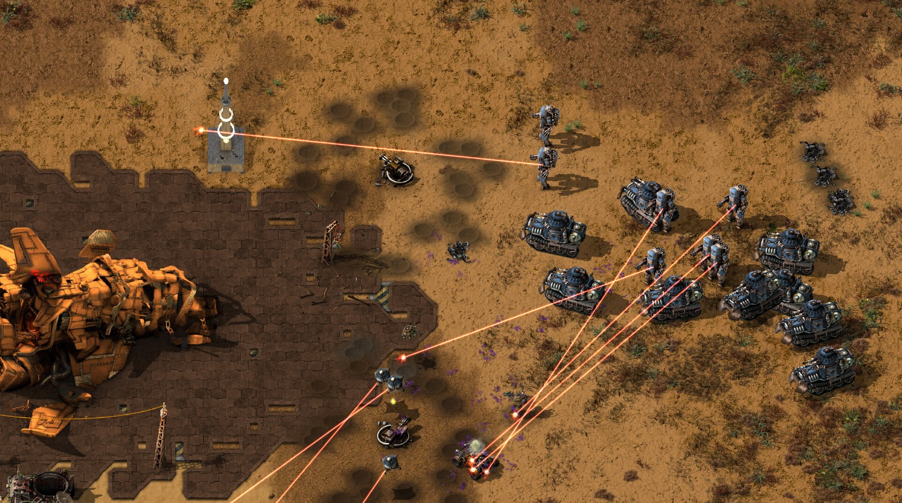

# Rivals {kicker="Between the factions"}

The factions compete with you and with each other. Each corporation camp shows its standing toward you under its name
in map view. The corporations also fight each other, and Synthexis chooses whom it attacks.

## Standing: rival, enemy, truce

- **Rival.** Grubstake starts here. A rival steals, by raids where no turret covers, by skims, strip camps, power taps and
  claims. It does not escalate.
- **Enemy.** Kessler-Hayashi is your enemy from the day it lands. Grubstake becomes one when you provoke it: you damage
  its buildings, units or trucks, you build on its ground, or you put a turret in reach of its camp. An enemy Grubstake
  raids with more of its army, and the longer it goes without destroying anything of yours, the harder it comes: claim
  jumpers, then guarded ground.
- **Truce.** Bought: Grubstake's at your trade post, Kessler-Hayashi's at its invoice post. While it lasts the
  corporation sends nothing at you (Grubstake still prospects). When it runs out, its standing goes back to what it
  was.

Destroying a lander makes its corporation your enemy, and its next landing comes angry (see [Arrivals](arrivals.qmd)).
The other factions take note of the fight but are not provoked by it.

**Standing down.** A corporation at war with you gives up if it keeps failing. A camp whose operations against you
fail  times in a row, or that destroys nothing of yours for 
minutes, stands down. Its aggression setting scales both, so an aggressive corporation keeps at it longer. While stood
down, it sends nothing at you, keeps its army to a reserve and only defends its own ground, so a turret you put up
there is still answered. It goes on mining and exporting. A new landing comes soon after, away from its site, and
after  minutes the camp tries again. A Grubstake camp that stands down forgives you and is a
rival again. Kessler-Hayashi stays an enemy.

## The corporations at war with each other

Kessler-Hayashi and Grubstake are at war with each other from the start. Grubstake lands away from Kessler-Hayashi,
but their camps raid each other, and their haulers and convoys get caught on the way. Their fights do not count against
the operations sent at you (see [Arrivals](arrivals.qmd)).

Each answers losses its own way. A Kessler-Hayashi camp that loses buildings or units at home to Grubstake in a short
time sends a punitive raid back soon after. Grubstake remembers who hurt it and keeps stealing, and sends no punitive
raids. Only losses at home count; units lost on their own raids are not held against anyone.

## Synthexis and the corporations

**Grubstake.** Synthexis and Grubstake keep a lasting truce that nothing breaks. Synthexis feeds on the pollution
Grubstake's drills put out, and the wild biters leave both of them alone. Synthexis never attacks Grubstake.

**Kessler-Hayashi.** Synthexis goes for Kessler-Hayashi only after Kessler-Hayashi has destroyed one of its incubators,
tumors or biochambers. Kessler-Hayashi treats incubators as it treats biter spawners, so a camp that keeps losing units to
them clears them. A Synthexis wave that takes heavy fire from a Kessler-Hayashi camp on its march turns on that camp
when it can afford to, then goes on.

## Playing them off

- **Pay one, fight the other.** A truce from Grubstake's trade post keeps its thieves off while you deal with
  Kessler-Hayashi, and the invoice post does the same the other way round. Place the trade post where its hauler will
  not cross Kessler-Hayashi's ground.
- **Let Kessler-Hayashi meet Synthexis.** A Kessler-Hayashi camp that loses units to a Synthexis culture clears its
  incubators, and from then on Synthexis sends waves at it as well as at you.
- **Set the biters on them.** Pheromone bait sends idle biters at a Kessler-Hayashi camp at any time, and at a Grubstake
  camp once its pact is broken (see [Grubstake](grubstake.qmd#sec-pact)).
- **Fight one without angering the other.** Provoking Grubstake or destroying a lander turns only that corporation
  against you.
- **Keep Grubstake a rival.** A rival steals, and an enemy escalates. When Kessler-Hayashi is the problem, guard what
  Grubstake would take and leave its camps alone.
