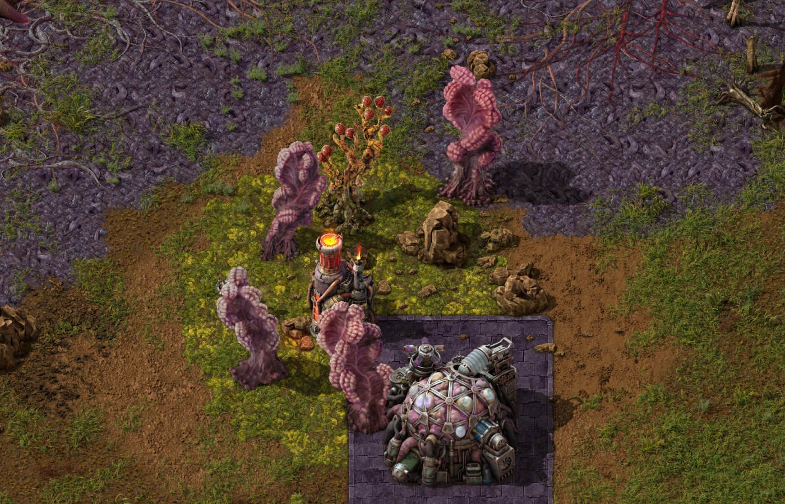
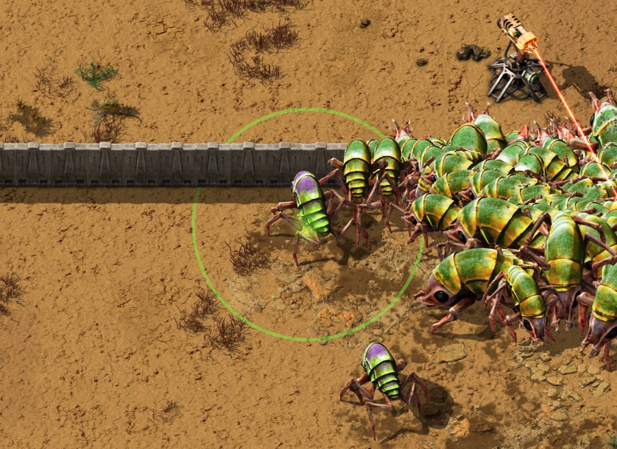
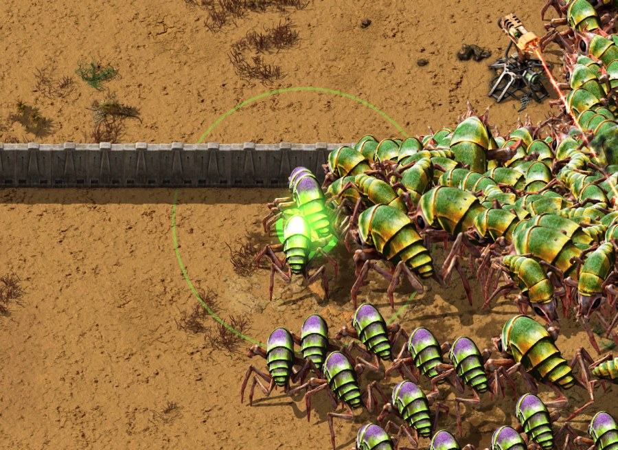
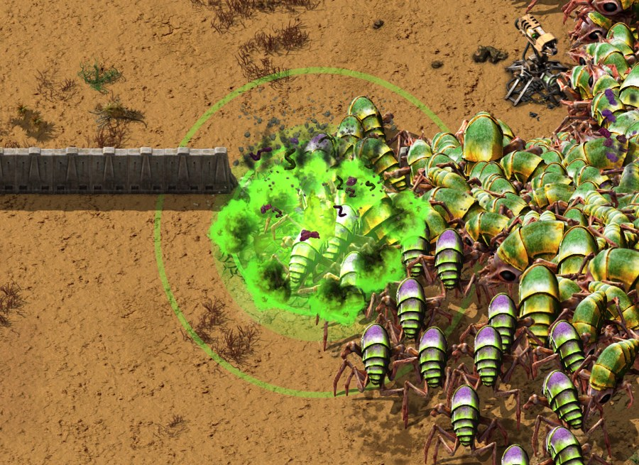

# Synthexis {.opener faction="synthexis" kicker="The corporations"}

::: {.epigraph faction="synthexis"}
:::

::: {.lore kicker="Background" title="The breeders" faction="synthexis"}

::: {.dossier}
SYNTHEXIS
: A biotech company. Its owners are not public. Motto: "Engineered to adapt."

BASED
: Five leased swamp lots on Gleba, for crops and pentapod study. Platform *Cold Chain*.

PEOPLE
: Dr. Anouk Verhaegen, head of the Nauvis program. Ilya Rask, senior technician.

ON NAUVIS
: No licence. No armed staff. A breeding program on the native swarm.
:::

Synthexis keeps a low profile. It leases five swamp lots on Gleba, where it grows crops and studies the pentapods,
and it deals with the outside world through an agent who answers every question with a lease number. Nobody outside
the company knows who owns it.

What Synthexis sells is life made to order: crops that grow faster, animals bred for a purpose. On Nauvis it found
the best breeding stock it had ever seen. The native biters adapt to whatever hurts them, and the engineer's pollution
has made them bigger and more aggressive every year.

So Synthexis came to breed them. Its platform *Cold Chain* lands a culture on a nest field, its technicians turn the
nests into incubators, and the biters that hatch wear the company's green and yellow bands. Then they are sent against
the engineer's walls. Synthexis keeps no soldiers on Nauvis; the biters do its fighting.

Dr. Anouk Verhaegen runs the program, and she does not think of it as a war. To her the engineer's factory is a test,
the hardest the stock has faced. Every wave that dies at a wall is written up, and the next one is bred for that wall.

::: {.pullquote cite="A. Verhaegen, field report"}
Batch lost at the southern wall. The wall held. Next batch to be bred for the wall.
:::
:::

Synthexis is a bioengineering company. It does not mine or build factories. It takes over a field of biter spawners,
feeds it on your pollution and breeds biters of its own, tinted green and yellow. Its waves pick a way in, go for what
keeps your turrets firing, and change after every attack that fails.

## Arrival

Synthexis lands when the wild biters' evolution on a surface reaches . Its pod comes
down on a spawner field between  and  tiles from your
buildings, never within reach of your artillery. Up to  of the field's spawners become
Synthexis incubators, each with bred biters and worms beside it. The landing is announced in chat and marked on your
map.

Synthexis is at peace with the wild biters, and they leave each other alone. It also keeps a lasting truce with Grubstake,
whose pollution it lives on.

## The culture

A culture (a trial site, in the company's own protocol) is the incubators and everything that keeps them breeding.

- **Synthexis incubator.** A spawner taken over by Synthexis. It holds up to  bred biters
  and drops pheromone glands when destroyed.
- **Synthexis biochamber.** One stands beside each incubator. While it works, the incubator breeds. If it is destroyed,
  or no technician has come to run it, the incubator stops breeding, keeps  of its biters
  and lets the rest go feral. After  minutes unfed it goes back to the wild.
- **Synthexis technician.** Walks between the biochambers and keeps them running. The culture buys more as it grows.
- **Synthexis tumor.** Spreads Synthexis creep. Nothing can be built on creep. An incubator cut off from the creep
  starves and goes back to the wild after  minutes, taking its biters with it.
- **Synthexis clinic.** Makes its breeds stronger over time (see [What it breeds](#sec-breeds)).
- **Synthexis heating tower** and **Synthexis lamp.** The culture's furniture, with no part in its waves.

::: {.callouts plan="media/plans/synthexis-culture.json" faction="synthexis" crop="420,120,1500,960" drop="5"}
A young culture by its lake, ten minutes after its landing.
:::

**Growth.** The creep spreads toward nearby wild spawners, and each one it reaches becomes an incubator, up to
. Where there is nothing left to take, the culture founds incubators of its own. A grown
culture sends a Synthexis carrier with an escort to a wild spawner field farther out to start a new culture there. Kill
the carrier on the way and the new culture never starts. When every incubator of a culture is destroyed, the culture is
gone, and Synthexis lands again on another field  minutes later.

**Biomass.** Every birth costs biomass. A culture earns it from the pollution its incubators and creep absorb, plus
 per incubator per minute whatever the air. Its pod brings
 to start. With no biomass left, its incubators stop until it earns more. The more
pollution reaches a culture, the faster it breeds. The **Synthexis: strength** setting scales how fast it breeds.

## What it breeds {#sec-breeds}

What an incubator breeds depends on Synthexis's own evolution.

::: {.tree tree="synthexis-breeds"}
A breed comes once Synthexis's evolution reaches the number under it, and the bigger breeds take a growing share of
what an incubator breeds from there on. The developed breeds come from what its waves have met; the rest it makes to
order, for a wave or for the culture.
:::

Its evolution is its own. While its clinic stands it climbs  an hour, never falls
behind the wild biters' and never gets more than  ahead of it. Destroy the clinic and the
climb stops: its incubators breed as at evolution  at most until a new clinic lands
 minutes later.

**The bursters.** A burster is a fast biter that does not bite. At a wall or turret it bursts, damaging what stands
nearby, and it also bursts wherever it is killed. A big burster is sent at one of the turrets covering a wave's way in.
At the turret, or at a wall on the way, it bursts and damages every turret nearby. Killed short of them, only its core
goes off, over half the reach. Synthexis develops it once your walls have held its waves
 times.

**The wind-up.** A burster that reaches its target stops where it stands and swells, glowing acid green and pulsing
faster, while a ring on the ground closes in from the edge of its blast. A burster bursts
 seconds after it stops, a big burster 
seconds after. Nothing harms it meanwhile, so it always bursts whole; to stop it, kill it before it gets there.

::: {.strip faction="synthexis"}

A burster at a wall, from the moment it stops to its blast.
:::

Only the spore spitter can hit a flying unit. Every breed has a card at the end of this chapter, and its full numbers
are in the [Reference](reference.qmd#sec-units).

## Waves

The first wave comes  minutes after the landing. After that, waves come one at a
time, at least  minutes apart. The **Synthexis: aggression** setting scales both.

**Size.** A wave is  to  biters. A culture with more than
 incubators sends bigger ones, up to . A home guard stays behind at the incubators.

**Targets.** You come first. Synthexis attacks Kessler-Hayashi only after Kessler-Hayashi has destroyed one of its
incubators, tumors or biochambers. It never attacks Grubstake or the wild biters.

**How a wave attacks.**

1. A scout circles your defenses. When you see one, a wave is on its way.
2. The wave picks its way in. Synthexis knows where your turrets are. It weighs each way in by the turrets that cover it
   and by what earlier waves lost there, and takes the cheapest.
3. It gathers out of turret range, then marches to its breach point.
4. Once it has a gap in your wall, the whole wave goes in through it and keeps inside, without chewing the wall beside
   it. Past your wall it keeps going to what it came for: your power, and the inserters that load your gun turrets. It
   does not stop to fight every turret on the way.
5. It goes home by the gap it came in through.

**What it learns.** Every wave leaves a lesson about the defense it hit. A way in that held costs more next time, so the
next wave may try another side. Where a wall held its last wave, the next wave there brings bursters,
% of its biters, and waits up to  minutes for
them. Where mines lie on its way in, it breeds sweepers for them.

**Sieges.** Where a wall stands in its way, a wave may come as a siege. A screen of its cheapest biters goes at the
wall first to draw your fire. Then its big bursters go at the turrets covering its way in, while the rest of the wave
waits back from the wall. It sends them in ranks, as many at a time as it takes for one to reach the wall alive. Each
rank gathers out of your guns' reach and goes in together. When a rank's blasts have opened the first wall and another
wall still stands between the gap and its target, the next rank goes through the gap at that wall. A rank killed before
any of it bursts makes the next one bigger, by as many as your guns killed on its way in. With the way open, its last
big bursters go at the turrets covering it, and the waiting biters rush in behind them, or once its big bursters are
spent.

**Through the gap.** The rush keeps to its own gap. If your robots have mended a piece of it, the wave breaks that piece
again rather than walking round to another opening. It only spreads out inside once most of it is past your wall; the
ones still outside are sent on through the gap after the rest.

**Spread assaults.** Synthexis keeps count of what kills its biters at each place. Where fire and explosions do most
of the killing (flamethrowers, mines, artillery), it may spread a siege's big bursters over several points of the
wall, chosen so no single flamethrower covers two of them, each point with a screen of its own. The waiting biters
rush the first gap any of them opens. Whether it spreads again at a place depends on how well its spreads there went.

## Its breeds {#sec-syn-units}



## Fighting Synthexis

- **Hit the supply.** Destroy a biochamber and its incubator stops breeding. A biochamber under attack does not call the
  wave home, so it is the quiet target while a wave is out.
- **Hit an incubator to call the wave back.** An incubator under attack recalls the wave on its way, and the fight moves
  back along its trail.
- **Kill the tumors.** Incubators cut off from the creep go back to the wild.
- **Kill the clinic** to stop its breeds getting stronger.
- **Starve it.** Less pollution reaching its field means less biomass and smaller waves.
- **Shoot the scouts.** A scout killed does not stop the wave, but the base it circles is the target.
- **Kill bursters at range.** Once one stops and swells, it will burst. A big burster killed before it reaches its
  turret bursts with its core alone.
- **Build in depth.** Each wall behind the first costs a siege another rank of big bursters, and its waiting biters
  hold back until every wall on the way is open. Guns that reach past your outer wall fire on them while they wait.
- **Do not rely on fire alone.** Against flamethrowers and mines it spreads its big bursters out. Lasers and gun
  turrets along the whole face still fire on every point.
- **Cover the inside of the gap.** Once a gap is open the whole wave pours through it, and it leaves the same way.
