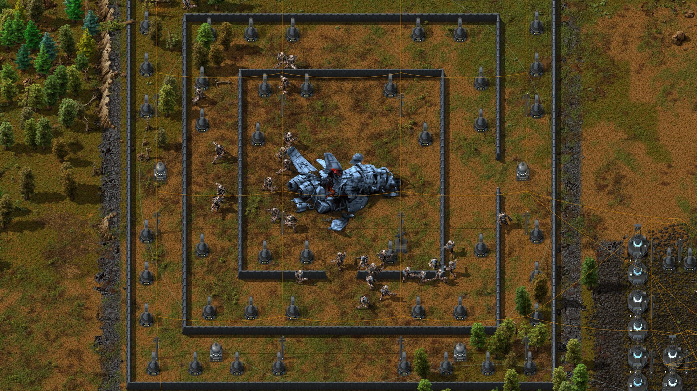

# Landing Party: mod portal page (draft)

Drafted 2026-11-10 for the user to edit, brought up to 0.2.339 on 2026-11-12, given its prose pass (portal comparison, picture first) on 2026-11-23, to 0.2.433 and to 0.2.438 on 2026-11-16,
to 0.2.464 on 2026-11-19, and to 0.2.497 (released as 0.3.0, a public beta) on 2026-11-23; the manual's link works once the v0.3.0 GitHub release carries the PDF; nothing here is published. Paste the part below the line into the portal's
"Information" field. Placeholders in [square brackets].

Portal fields:
- **Title:** Landing Party
- **Summary (one line):** Three rival factions come to Nauvis with armies of their own: Grubstake steals, Kessler-Hayashi walls off its ground and besieges you, Synthexis breeds biters.
- **Category:** Content (the portal's categories: content, overhaul, tweaks, utilities...; scripts/portal.py sets it)
- **Tags:** Combat, Enemies (the portal's own tag list has no planets or size tags)
- **License:** MIT
- **Source:** https://github.com/kinelhu/landing-party
- **Version:** 0.3.0, a public beta
- **Gallery:** docs/release/gallery/*.jpg, in order (captions below, under "Gallery captions")
- **Loops in the text:** media/release/gifs/, each an MP4 (a few hundred kB; the portal plays mp4 and webm inline with
  the image syntax) and a GIF fallback (3 to 8 MB). Placeholders [gif: name] mark where each goes, once hosted.
- **Thumbnail:** landing-party/thumbnail.png (in the mod; 144 by 144)

---

Three rival factions come to Nauvis and fight you and each other for it. Grubstake and Kessler-Hayashi build walled
camps that mine ore and make their armies in their own factories. Synthexis breeds biters in the nests it takes over.

[Trailer on YouTube](https://www.youtube.com/watch?v=Xmsl4OdcdWY)

**Before you start.** Factorio 2.1 with Space Age. It works on a new game or an existing one. This is a public beta. Everything is tested by scripted
runs and a few played sessions, but the difficulty is not tuned yet. Tell us on the discussion page or in a GitHub issue
what felt unfair, dull or broken, with the version and, if you can, a save.

## The factions

**Grubstake** comes once you make chemical science. It is a prospecting outfit that would rather steal than destroy. It
raids what you leave unguarded, skims your belts, strips your ore and drives Dozers through your walls, and it keeps what
it takes in its scrapyard until you destroy the yard.

[gif: flak]

**Kessler-Hayashi** comes after your first rocket: an armed contractor run from orbit. It pushes a line of posts toward
you, cuts off your outposts, shells your walls with mortars and calls down orbital strikes. Its camps sit inside laser
turret lines, under shield domes that stop artillery shells. Its railgunners clear the biter nests around it.

[gif: arcflamer] [gif: tesla]

**Synthexis** comes once the biters have evolved far enough. It takes over their nests and breeds its own strains in
them. Its scouts circle your walls before an
attack, and where an attack failed it tries something else the next time.

[gif: burst-wall]

Each faction chooses raids, sieges, thefts or air strikes by what your defenses are weakest against, and judges your army
by what it can do: its research, its ranks and its ammunition. The corporations research in labs you can find and
destroy, at your own technologies' levels, and never get far past you. On a map where the biters have evolved far, their
camps put flame turrets round every block and mine before the biters come.

[gif: prism] [gif: bombers]

## Headquarters

Each corporation has a headquarters that paces its attacks, with busy spells and quiet ones and no warning of either.

- **Strike forces** come down by pod beside something the headquarters wants, where your turrets reach least: power and
  the pumps feeding your boilers for Grubstake, rocket silos and labs for Kessler-Hayashi, train stations, roboports or oil
  for either. A turret that keeps killing their units becomes a target. Once a force has lost too many, it walks home.
- **Warning:** you are told when a strike force lands. With radar over the landing spot you see the pods coming up to two
  minutes ahead. A strike on your power is always announced, its target marked.
- **The right units for the job:** a strike force brings what beats the guns and troops guarding its target. It is never
  more than half again as strong as the largest army your command research lets you field.
- **Other events:** a mast that keeps pausing your rocket silo, another that blinds your radars, a bounty on one of your
  buildings, a crashed shuttle with salvage and its crew, joint strikes by both corporations.

[gif: pods] [gif: strike-fight] [gif: walk-home]

The Director setting chooses the pace (Steady, Gentle or Chaotic), or turns the headquarters off and leaves each faction
to act alone.

## Your army

- **Barracks** train troopers, breachers, rocket troopers, flamethrower troopers, gun buggies and battle tanks from your
  own equipment. Command them with the command tool (ALT + C) or with rally beacons. A panel at the top of the screen shows
  your units against your command capacity; retire the ones you no longer need (ALT + R).
- **Rally beacons** set a squad's stance by signal: hold, advance, retreat or defend. A defending squad goes out to a
  strike force your radar sees, to enemies at your buildings or to a gun shelling your walls, and comes back after. A
  beacon's panel sets how many of each unit it keeps, and units move between beacons as you change the numbers.
- **Watch posts:** give a beacon a channel and the defending squads on that channel answer attacks within its reach,
  nearest first, more when the attackers outweigh one squad. In alt mode each squad wears its channel's color.
- **Circuits:** a beacon reads its stance, rally point and reach from signals, and reports its squad, the enemies near it,
  an alarm and its magazines by kind. Patrols and outposts that call for help are built from combinators.
- **Ammunition:** units carry the rounds of their order and spend them. A unit that runs dry raises an alert and walks to
  a barracks to rearm; supply depots your robots fill rearm squads at the front. Better orders train troopers on piercing
  or uranium magazines, tanks on uranium or explosive shells. A startup setting turns ammunition off.
- **Repair and ranks:** units heal near a powered barracks, and construction robots repair them. Units that kill earn
  ranks (Veteran, Elite, Heroic) for more health and damage. The corporations' units rank too.
- **Selection:** selected units show a card each above the quickbar. CONTROL + 1 to 9 saves a group, ALT + 1 to 9 recalls
  it.
- **Orbital cannons:** late in the game, build cannons on a space platform over Nauvis, supply them from the ground, and
  call strikes with a remote (ALT + O).
- **Spoils:** each faction's technology can be recovered from its wreckage, from cluster shells to rail rifles.

[gif: cannon-strike]

## Sound

The corporations' units have their own weapons, engines, footsteps and deaths, Grubstake's heavy and rough,
Kessler-Hayashi's tight and electric. Their events have their own cues: a klaxon as a strike force's pods come down, a
siege horn, a shield dome stopping a shell.

## Settings

The Director and a difficulty preset. For each faction: whether it comes, when, how many bases it may have, its strength,
aggression and income, and how fast it researches. Also the time between landings, Kessler-Hayashi's orbital strikes,
Grubstake's theft, and your army's ammunition.

## Notes

- Saves made on an earlier version load on a later one.
- Multiplayer: tested with a second player joining through sieges and strike forces, without desyncs. Two players using
  the army at the same time has not been tested yet.
- No known incompatible mods. Please report clashes on the discussion page.
- [Player manual (PDF)](https://github.com/kinelhu/landing-party/releases/download/v0.3.0/Landing-Party-manual.pdf)
- Source and issues: [github.com/kinelhu/landing-party](https://github.com/kinelhu/landing-party)

## Use of AI

Claude (Anthropic) was used to write the mod's code, build its 3D models in Blender and draft its manual. The textures
are CC0 materials from ambientCG and Poly Haven; no image-generation model was used. The author designed the mod,
playtested it and reviewed every change. Behaviour is verified by scripted headless test games before each release.

## Gallery captions

1. A Kessler-Hayashi fortress inside its rings of wall, its lander at the centre and its mine beside it.
2. Your army attacking a Grubstake camp.
3. A Synthexis swarm against a flamethrower wall.
4. A Kessler-Hayashi orbital strike opening a wall.
5. A Kessler-Hayashi shield dome over its camp, catching your artillery's shells.
6. A Synthexis culture: captured spawners breeding its biters.
7. Grubstake bomb drones diving on a squad of troopers.
8. A Grubstake Dozer charging through a wall.
9. Two of your orbital cannons on a space platform, firing down on Nauvis.
10. An orbital strike from your cannons on a Synthexis culture.
11. A Kessler-Hayashi strike force's pods coming down beside your furnaces.
12. Three squads in alt mode, each wearing its channel's colour, under their rally beacons.
13. Grubstake's Workshop at work, between its depot and its fabricator.

Loops (media/release/gifs, docs/release/gifs.sh; manifest.json has each one's caption, length and sizes): pods,
strike-fight and walk-home (the director's film set, docs/release/strike-film.lua, 2026-11-16); tesla, bombers, prism,
flak (the showcase film, 2026-11-12); arcflamer (0.2.350); cannon-strike (the trailer's culture reel, 2026-11-12).
(swarm-breach, the trailer's breach shot, was cut 2026-11-24 and dropped: the user read its swarm rushing the gap and
falling back out as a bug.) burst-wall (the trailer's burster shot, its first 5 s, 2026-11-24) is in its place.
The 2026-11-12 sources stay in media/release/loops.
