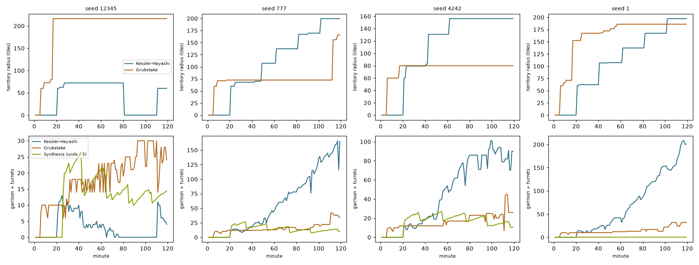

# The whole system's balance

Generated by `scripts/system_report.py` from `scenarios.system` runs (tests/lp-sim): every faction on one map
with a stand-in for the player, a frame a minute. Targets and their reasons: the script's docstring.

| seed | minutes | survive | even | shapes | fights | pressure |
|---|---|---|---|---|---|---|
| 12345 | 119 | met | met | **missed** | **missed** | met |
| 777 | 119 | met | met | met | **missed** | met |
| 4242 | 119 | met | met | **missed** | met | met |
| 1 | 119 | **missed** | met | met | **missed** | **missed** |

### Seed 12345
- **survive** (met): live bases: Kessler-Hayashi 1, Grubstake 1; Synthexis cultures 1
- **even** (met): Kessler-Hayashi lost 19, Grubstake lost 10; Kessler-Hayashi lost 0, Synthexis lost 0; Grubstake lost 0, Synthexis lost 0
- **shapes** (missed): at minute 45: ground held (camps and claims) Grubstake 1, Kessler-Hayashi 1; territory radius Grubstake 216, Kessler-Hayashi 72; garrison and turrets at the end: Kessler-Hayashi 4, Grubstake 24
- **fights** (missed): Kessler-Hayashi lost 91 to Grubstake, Grubstake 81 to Kessler-Hayashi; Synthexis lost 0 to Kessler-Hayashi
- **pressure** (met): operations against the player: Kessler-Hayashi 1, Grubstake 7; Synthexis waves 4; the player lost 0 buildings to them

### Seed 777
- **survive** (met): live bases: Kessler-Hayashi 1, Grubstake 2; Synthexis cultures 1
- **even** (met): Kessler-Hayashi lost 0, Grubstake lost 0; Kessler-Hayashi lost 0, Synthexis lost 0; Grubstake lost 0, Synthexis lost 0
- **shapes** (met): at minute 45: ground held (camps and claims) Grubstake 1, Kessler-Hayashi 1; territory radius Grubstake 73, Kessler-Hayashi 70; garrison and turrets at the end: Kessler-Hayashi 165, Grubstake 34
- **fights** (missed): Kessler-Hayashi lost 0 to Grubstake, Grubstake 4 to Kessler-Hayashi; Synthexis lost 235 to Kessler-Hayashi
- **pressure** (met): operations against the player: Kessler-Hayashi 6, Grubstake 2; Synthexis waves 5; the player lost 2 buildings to them

### Seed 4242
- **survive** (met): live bases: Kessler-Hayashi 2, Grubstake 1; Synthexis cultures 1
- **even** (met): Kessler-Hayashi lost 0, Grubstake lost 0; Kessler-Hayashi lost 0, Synthexis lost 0; Grubstake lost 0, Synthexis lost 0
- **shapes** (missed): at minute 45: ground held (camps and claims) Grubstake 1, Kessler-Hayashi 1; territory radius Grubstake 80, Kessler-Hayashi 131; garrison and turrets at the end: Kessler-Hayashi 90, Grubstake 26
- **fights** (met): Kessler-Hayashi lost 13 to Grubstake, Grubstake 16 to Kessler-Hayashi; Synthexis lost 143 to Kessler-Hayashi
- **pressure** (met): operations against the player: Kessler-Hayashi 8, Grubstake 4; Synthexis waves 5; the player lost 6 buildings to them

### Seed 1
- **survive** (missed): live bases: Kessler-Hayashi 2, Grubstake 1; Synthexis cultures 0
- **even** (met): Kessler-Hayashi lost 0, Grubstake lost 0; Kessler-Hayashi lost 0, Synthexis lost 0; Grubstake lost 0, Synthexis lost 0
- **shapes** (met): at minute 45: ground held (camps and claims) Grubstake 1, Kessler-Hayashi 1; territory radius Grubstake 172, Kessler-Hayashi 107; garrison and turrets at the end: Kessler-Hayashi 201, Grubstake 32
- **fights** (missed): Kessler-Hayashi lost 0 to Grubstake, Grubstake 0 to Kessler-Hayashi; Synthexis lost 0 to Kessler-Hayashi
- **pressure** (missed): operations against the player: Kessler-Hayashi 5, Grubstake 2; Synthexis waves 0; the player lost 0 buildings to them
